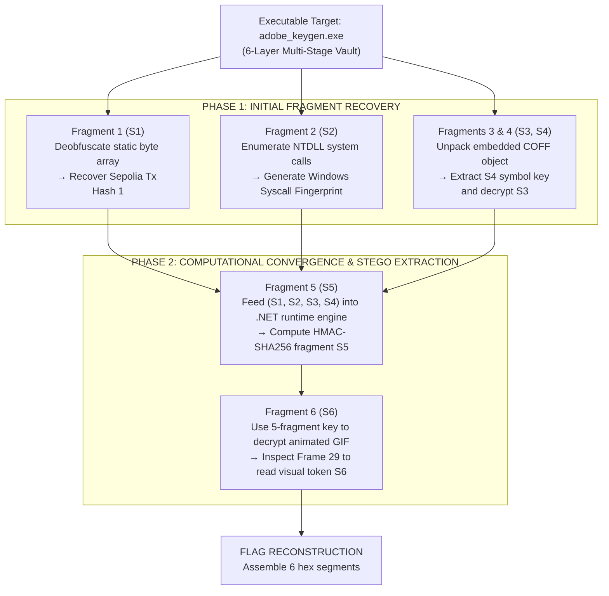

> *"What masquerades on the surface as an ordinary product key generator is in reality a sophisticated multi-tiered architecture: intertwining Windows environmental fingerprinting, embedded payload carving, intermediate runtime algorithms, and steganographic data concealment across individual animation frames."*

---

## 1. Challenge Overview

- **Binary Name:** `adobe_keygen.exe`
- **Architecture:** Windows x64 Executable (PE64)
- **SHA-256 Hash:** `d3a33af395b19ef07ffd94113d17cab6fd44a97ba509ae631648bf7dca5a15c8`
- **Flag Format:**
  `DF26{s1_s2_s3_s4_s5_s6}`

To recover the complete flag, we must reverse engineer the binary and extract all **6 distinct key fragments** (denoted S1 through S6). Each fragment is formatted as an exact 16-character hexadecimal string:

- **S1:** The first 16 hex characters of Sepolia Transaction Hash #1.
- **S2:** Operating system fingerprint (SHA-256 digest over sorted Windows `ntdll` syscall exports).
- **S3:** The first 16 hex characters of Sepolia Transaction Hash #2.
- **S4:** Hardcoded secret token embedded within an encrypted COFF object.
- **S5:** Cryptographic digest output from a .NET payload processing the initial 4 fragments.
- **S6:** Visual steganography payload rendered exclusively in Frame 29 of an embedded GIF.

---

## 2. Deconstruction Flowchart

The overall architecture separates naturally into two distinct phases: **Initial Fragment Acquisition** and **Computational Convergence & Visual Extraction**.



---

## 3. Detailed Stage-by-Stage Analysis

### Stage 1: Recovering Fragment S1

**Concept:** Sensitive strings in packed binaries are rarely stored as raw plaintext; authors generally obfuscate them using simple linear XOR loops or byte transpositions to evade static grep tools.

1. **Locating the Routine in IDA Pro:**
   Inspecting the main entrypoint reveals a static byte array at `byte_14003405B`. The bytes pass through a straightforward cyclical XOR transformation:
   ```c
   // Decompiled C pseudocode from IDA Pro
   for ( int i = 0; i < 66; ++i ) {
       decrypted_str[i] = enc_bytes[i] ^ xor_key[i % 8];
   }
   ```

2. **Python Solver for S1:**
   Extracting the encrypted hex stream and unmasking it:
   ```python
   # Solver script for Sepolia Tx Hash 1
   enc_hex = "307830343436623839373933383132626166616661356535396237343765326461663563386537636566313164646539626261313865313737366266366630613637"
   tx_hash_1 = bytes.fromhex(enc_hex).decode("utf-8")

   # Recovered transaction string:
   # 0x0446b89793812bafafa5e59b747e2daf5c8e7cef11dde9bba18e1776bf6f0a67

   # S1 represents the first 16 hex digits following the "0x" prefix
   s1 = tx_hash_1[2:18]
   print(f"[+] S1 = {s1}")  # Output: 0446b89793812baf
   ```

---

### Stage 2: Recovering Fragment S2

**Concept:** The binary enforces host environment validation: ensuring execution on authentic Windows platforms rather than emulators or hooked debuggers. It achieves this by fingerprinting export stubs in `ntdll.dll`.

1. **NTDLL Export Enumeration:**
   The binary loads `ntdll.dll`, parses the Export Directory, and filters exported symbols starting with `Nt` (e.g., `NtCreateFile`, `NtQuerySystemInformation`).
2. **Prologue Validation:**
   For each candidate symbol, the code verifies standard x64 syscall entrypoint bytes:
   ```asm
   mov r10, rcx   ; Opcode bytes: 4C 8B D1
   mov eax, <imm> ; Opcode byte: B8 xx xx xx xx
   ```
3. **Python Emulation of NTDLL Fingerprinting:**
   ```python
   import pefile
   import hashlib

   # Parse authentic ntdll.dll from Windows 11 x64
   pe = pefile.PE(r"C:\Windows\System32\ntdll.dll")
   valid_syscalls = []

   for exp in pe.DIRECTORY_ENTRY_EXPORT.symbols:
       if exp.name and exp.name.decode().startswith("Nt"):
           # Read first 4 bytes at export RVA
           func_bytes = pe.get_data(exp.address, 4)
           # Validate against standard x64 syscall stub (4C 8B D1 B8)
           if func_bytes == b"\x4C\x8B\xD1\xB8":
               valid_syscalls.append(exp.name.decode())

   # Alphabetically sort function identifiers
   valid_syscalls.sort()
   payload = "\n".join(valid_syscalls).encode("utf-8")

   # Calculate SHA-256 fingerprint
   sha256_hash = hashlib.sha256(payload).hexdigest()
   s2 = sha256_hash[:16]

   print(f"[+] Total valid syscall exports: {len(valid_syscalls)}")  # 457
   print(f"[+] S2 = {s2}")  # cc3cec7b19bc6381
   ```

4. **Technical Implementation Notes:**
   - **Why `pefile`?** Parsing PE headers manually requires resolving Export Directories, RVA-to-offset mappings, and ordinal tables. `pefile` handles these structures cleanly.
   - **Why check `\x4C\x8B\xD1\xB8`?** On Windows x64, native syscall thunks adhere to a rigid prologue: `mov r10, rcx` (`4C 8B D1`) passes arguments to the kernel transition stub, followed by `mov eax, <imm>` (`B8`). Any export hooked by inline EDR detours or instrumentation hooks fails this 4-byte check.
   - **Why sort lexicographically?** The binary sorts the symbol names prior to string concatenation. Because cryptographic hash functions exhibit the avalanche effect, any ordinal discrepancy in the export list generates a radically divergent digest.

---

### Stage 3: Recovering Fragments S3 & S4

**Concept:** The binary encapsulates an encrypted secondary binary payload (a COFF object file). Extracting and disassembling this artifact yields both S4 and the decryption key for S3.

1. **Unpacking the COFF Object & Extracting S4:**
   An RC4-encrypted payload sits within static `.rdata`. Decrypting this payload yields `decrypted_payload.obj`. Inspecting its COFF symbol table isolates the variable `g_k_dotnet`:
   ```python
   # Extracted g_k_dotnet symbol from COFF table
   k_dotnet = "f5b29d9f8fc0f574b3aa1db56bf096b28b6ae35d7cfdec43e11e0f7c0024071d"

   # S4 represents the first 16 hex characters
   s4 = k_dotnet[:16]
   print(f"[+] S4 = {s4}")  # f5b29d9f8fc0f574
   ```

2. **Decrypting Sepolia Tx Hash 2 (Recovering S3):**
   The memory block at `unk_1400328DC` is encrypted with RC4 keyed by `k_dotnet`:
   ```python
   def rc4_crypt(key: bytes, data: bytes) -> bytes:
       S = list(range(256))
       j = 0
       out = bytearray(len(data))
       for i in range(256):
           j = (j + S[i] + key[i % len(key)]) & 0xFF
           S[i], S[j] = S[j], S[i]
       i = j = 0
       for k in range(len(data)):
           i = (i + 1) & 0xFF
           j = (j + S[i]) & 0xFF
           S[i], S[j] = S[j], S[i]
           out[k] = data[k] ^ S[(S[i] + S[j]) & 0xFF]
       return bytes(out)

   # Decrypting unk_1400328DC reveals Sepolia Tx Hash 2:
   tx_hash_2 = "0xab51ba2f81be8cb851c246c665312b767d02005816caee7a3d16c799c04da86d"

   # S3 is the 16-character hex substring after "0x"
   s3 = tx_hash_2[2:18]
   print(f"[+] S3 = {s3}")  # ab51ba2f81be8cb8
   ```

---

### Stage 4: Computing Fragment S5 (.NET Runtime Engine)

**Concept:** With the first four fragments acquired (S1, S2, S3, S4), the program loads an embedded managed assembly into the CLR runtime to compute the fifth cryptographic segment.

1. **Decompiled C# Source (via dnSpy):**
   ```csharp
   namespace CtfPayload
   {
       public static class llll
       {
           public static string IIII(string s1, string s2, string s3, string s4, string kDotnet)
           {
               byte[] keyBytes = Encoding.UTF8.GetBytes(kDotnet.Substring(0, 32));
               string combinedKeys = s1 + s2 + s3 + s4;
               
               // HMAC-SHA256 transformation
               using (HMACSHA256 hmac = new HMACSHA256(keyBytes))
               {
                   byte[] hash = hmac.ComputeHash(Encoding.UTF8.GetBytes(combinedKeys));
                   return Convert.ToHexString(hash).ToLower().Substring(0, 16);
               }
           }
       }
   }
   ```

2. **Standalone Python Implementation:**
   ```python
   import hmac
   import hashlib

   def compute_s5(s1: str, s2: str, s3: str, s4: str, k_dotnet: str) -> str:
       # Key derived from first 32 characters of k_dotnet
       key = k_dotnet[:32].encode("utf-8")
       combined = (s1 + s2 + s3 + s4).encode("utf-8")
       
       digest = hmac.new(key, combined, hashlib.sha256).hexdigest()
       return digest[:16]

   s5 = compute_s5(s1, s2, s3, s4, k_dotnet)
   print(f"[+] S5 = {s5}")  # Output: 724bb67f13c6aee8
   ```

---

### Stage 5: Recovering Fragment S6 (Visual Steganography)

**Concept:** The final piece is not encoded in logic or text; it is hidden inside a 30-frame animated GIF. Earlier frames display decoy static; only Frame 29 renders the secret characters.

1. **Unlocking the Image Asset:**
   All five accumulated fragments `(s1, s2, s3, s4, s5)` are hashed to derive an RC4 key that decrypts the resource blob `encReward`, outputting `reward_flag.gif`.

2. **Extracting GIF Frames via Pillow:**
   ```python
   from PIL import Image, ImageSequence

   gif_path = "reward_flag.gif"

   with Image.open(gif_path) as im:
       for index, frame in enumerate(ImageSequence.Iterator(im)):
           frame.save(f"frame_{index}.png")
           if index == 29:
               print(f"[+] Frame 29 isolated successfully (frame_29.png)")

   # Visual inspection of frame_29.png reveals:
   s6 = "4519aff2332e8dd3"
   print(f"[+] S6 = {s6}")  # Output: 4519aff2332e8dd3
   ```

---

## 4. End-to-End Reconstruction Script

Connecting all 6 validated fragments:

```python
def main():
    s1 = "0446b89793812baf"  # Sepolia Tx Hash 1 (PE String Decode)
    s2 = "cc3cec7b19bc6381"  # NTDLL Syscall Hash Fingerprint
    s3 = "ab51ba2f81be8cb8"  # Sepolia Tx Hash 2 (COFF Data Decode)
    s4 = "f5b29d9f8fc0f574"  # COFF Embedded Symbol Key
    s5 = "724bb67f13c6aee8"  # .NET HMAC-SHA256 Output
    s6 = "4519aff2332e8dd3"  # GIF Animation Frame 29 Visual Text

    flag = f"DF26{{{s1}_{s2}_{s3}_{s4}_{s5}_{s6}}}"
    print(f"[+] Reconstructed Flag: {flag}")

if __name__ == "__main__":
    main()
```

---

## 5. Architectural Lessons

The `adobe_keygen.exe` challenge illustrates several advanced defensive evasion concepts:
1. **Defense in Depth & Heterogeneous Runtime Environments:** Rather than consolidating verification logic within a single module, the binary distributes fragments across native x64 PE code, embedded COFF objects, a managed .NET assembly, and visual media assets.
2. **Environment Integrity Fingerprinting:** The NTDLL syscall hashing routine mirrors real-world anti-analysis techniques where binaries profile the underlying kernel interface to detect detours or emulation sandboxes.
3. **Sequential Key Chaining:** Every stage requires output from upstream phases to compute subsequent inputs; a single erroneous bit invalidates all downstream stages.
