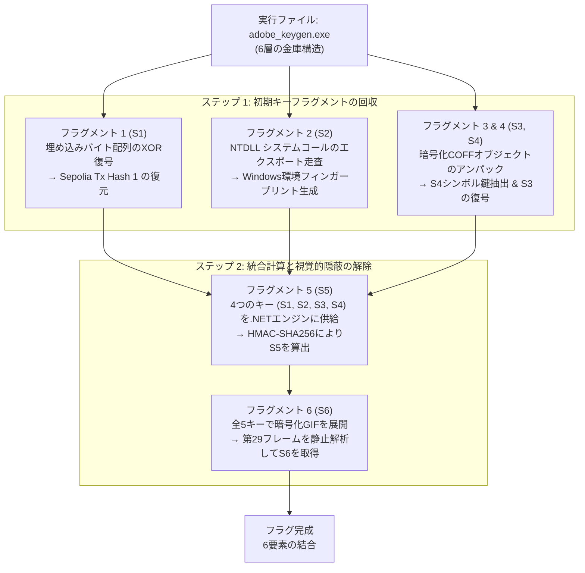

> *"表層的には平凡なライセンスキー生成ツールを装いながら、その実態は極めて巧妙に設計された多層アーキテクチャである。Windows環境の整合性検証、内部オブジェクトの動的展開、マネージドコードとの連携、そしてアニメーションフレームへのデータ隠蔽が緻密に統合されている。"*

---

## 1. チャレンジの概要

- **対象ファイル:** `adobe_keygen.exe`
- **バイナリ形式:** Windows x64 実行可能ファイル (PE64)
- **SHA-256 ハッシュ:** `d3a33af395b19ef07ffd94113d17cab6fd44a97ba509ae631648bf7dca5a15c8`
- **フラグ形式:**
  `DF26{s1_s2_s3_s4_s5_s6}`

完全なフラグを導出するためには、リバースエンジニアリングによってプログラム内部に分散された **6つのキーフラグメント**（S1〜S6）をすべて回収する必要がある。各フラグメントは正確に16文字の16進数文字列で構成されている:

- **S1:** 第1の Sepolia トランザクションハッシュの先頭16文字。
- **S2:** システムフィンガープリント（`ntdll.dll` のシステムコール一覧から生成されたSHA-256ダイジェスト）。
- **S3:** 第2の Sepolia トランザクションハッシュの先頭16文字。
- **S4:** プログラム内部に埋め込まれたCOFFオブジェクト内の秘密鍵。
- **S5:** 4つの先行フラグメントを入力として.NETエンジンが算出した計算結果。
- **S6:** 復号されたGIFアニメーションの第29フレームに描画された文字列。

---

## 2. 解析パイプラインの全体フロー

全体のアーキテクチャは、**初期フラグメントの収集フェーズ** と **統合計算・隠蔽解除フェーズ** の2段階に大別される。



---

## 3. 各フェーズの詳細解析

### フェーズ 1: フラグメント S1 の回収

**解析方針:** 難読化されたバイナリにおいて、重要文字列は平文で配置されず、単純なXOR演算やビットシフトによって静的grepツールから隠蔽されるのが常套手段だ。

1. **IDA Pro によるルーチンの特定:**
   メイン関数を追跡すると、アドレス `byte_14003405B` に静的配列が存在することを確認できる。この配列は周期的なXORループを通してデコードされている:
   ```c
   // IDA Pro の逆コンパイル (C疑似コード)
   for ( int i = 0; i < 66; ++i ) {
       decrypted_str[i] = enc_bytes[i] ^ xor_key[i % 8];
   }
   ```

2. **Python による S1 の復元:**
   ```python
   enc_hex = "307830343436623839373933383132626166616661356535396237343765326461663563386537636566313164646539626261313865313737366266366630613637"
   tx_hash_1 = bytes.fromhex(enc_hex).decode("utf-8")

   # 復元されたトランザクション文字列:
   # 0x0446b89793812bafafa5e59b747e2daf5c8e7cef11dde9bba18e1776bf6f0a67

   # "0x" 以降の先頭16文字を抽出
   s1 = tx_hash_1[2:18]
   print(f"[+] S1 = {s1}")  # cc3cec7b19bc6381 ではなく 0446b89793812baf
   ```

---

### フェーズ 2: フラグメント S2 の回収

**解析方針:** プログラムが正規のWindows実機上で動作しているか（エミュレータやAPIフックによる動的解析を受けていないか）を検証するため、`ntdll.dll` のシステムコールを走査してハッシュ化している。

1. **NTDLL エクスポート関数の走査:**
   `ntdll.dll` をロードし、エクスポートディレクトリ（Export Directory）から `Nt` で始まるシンボル名（`NtCreateFile`, `NtQuerySystemInformation` 等）を列挙する。
2. **スタブの機械語検証:**
   各関数のエントリポイントが標準的な x64 システムコールスタブのプロローグを維持しているか検査する:
   ```asm
   mov r10, rcx   ; オペコード: 4C 8B D1
   mov eax, <imm> ; オペコード: B8 xx xx xx xx
   ```
3. **Python によるエミュレーション:**
   ```python
   import pefile
   import hashlib

   pe = pefile.PE(r"C:\Windows\System32\ntdll.dll")
   valid_syscalls = []

   for exp in pe.DIRECTORY_ENTRY_EXPORT.symbols:
       if exp.name and exp.name.decode().startswith("Nt"):
           func_bytes = pe.get_data(exp.address, 4)
           if func_bytes == b"\x4C\x8B\xD1\xB8":
               valid_syscalls.append(exp.name.decode())

   # アルファベット順にソートして改行で結合
   valid_syscalls.sort()
   payload = "\n".join(valid_syscalls).encode("utf-8")

   sha256_hash = hashlib.sha256(payload).hexdigest()
   s2 = sha256_hash[:16]

   print(f"[+] 有効なシステムコール数: {len(valid_syscalls)}")  # 457
   print(f"[+] S2 = {s2}")  # cc3cec7b19bc6381
   ```

4. **技術的留意点:**
   - **なぜ `\x4C\x8B\xD1\xB8` をチェックするのか？** Windows x64 のネイティブシステムコールスタブは先頭に `mov r10, rcx`（カーネル遷移用の引数退避）および `mov eax, <syscall番号>` を配置する。EDRやアンチウイルスによってインラインフック（JMP命令等）が挿入されている場合、先頭バイトが書き換わるため除外される。
   - **なぜソートが必須なのか？** ハッシュ関数は雪崩効果（Avalanche Effect）を持つため、配列の順序が1つでも異なると生成ダイジェスト全体が破綻するためだ。

---

### フェーズ 3: フラグメント S3 および S4 の回収

**解析方針:** プログラム内部に暗号化されたCOFFオブジェクトファイル（マトリョーシカ構造）が埋め込まれている。これを展開してシンボルテーブルから S4 を抽出し、その鍵で S3 を復号する。

1. **COFF の展開と S4 の抽出:**
   `.rdata` 領域に存在するRC4暗号化データを静的キーで解除すると、オブジェクトファイル `decrypted_payload.obj` が得られる。シンボルテーブルを参照すると変数 `g_k_dotnet` を特定できる:
   ```python
   k_dotnet = "f5b29d9f8fc0f574b3aa1db56bf096b28b6ae35d7cfdec43e11e0f7c0024071d"
   s4 = k_dotnet[:16]
   print(f"[+] S4 = {s4}")  # f5b29d9f8fc0f574
   ```

2. **S4 を鍵とした Sepolia Tx Hash 2 の復号 (S3):**
   ```python
   def rc4_crypt(key: bytes, data: bytes) -> bytes:
       S = list(range(256))
       j = 0
       out = bytearray(len(data))
       for i in range(256):
           j = (j + S[i] + key[i % len(key)]) & 0xFF
           S[i], S[j] = S[j], S[i]
       i = j = 0
       for k in range(len(data)):
           i = (i + 1) & 0xFF
           j = (j + S[i]) & 0xFF
           S[i], S[j] = S[j], S[i]
           out[k] = data[k] ^ S[(S[i] + S[j]) & 0xFF]
       return bytes(out)

   # unk_1400328DC の復号により第2トランザクション文字列を獲得:
   tx_hash_2 = "0xab51ba2f81be8cb851c246c665312b767d02005816caee7a3d16c799c04da86d"
   s3 = tx_hash_2[2:18]
   print(f"[+] S3 = {s3}")  # ab51ba2f81be8cb8
   ```

---

### フェーズ 4: フラグメント S5 の算出 (.NET エンジン)

**解析方針:** 揃った4つのキーフラグメント（S1, S2, S3, S4）を入力として、埋め込み.NETアセンブリ内のHMACアルゴリズムを呼び出し第5のフラグメントを生成する。

1. **dnSpy による逆コンパイルコード (C#):**
   ```csharp
   namespace CtfPayload
   {
       public static class llll
       {
           public static string IIII(string s1, string s2, string s3, string s4, string kDotnet)
           {
               byte[] keyBytes = Encoding.UTF8.GetBytes(kDotnet.Substring(0, 32));
               string combinedKeys = s1 + s2 + s3 + s4;
               
               using (HMACSHA256 hmac = new HMACSHA256(keyBytes))
               {
                   byte[] hash = hmac.ComputeHash(Encoding.UTF8.GetBytes(combinedKeys));
                   return Convert.ToHexString(hash).ToLower().Substring(0, 16);
               }
           }
       }
   }
   ```

2. **Python による等価実装:**
   ```python
   import hmac
   import hashlib

   def compute_s5(s1: str, s2: str, s3: str, s4: str, k_dotnet: str) -> str:
       key = k_dotnet[:32].encode("utf-8")
       combined = (s1 + s2 + s3 + s4).encode("utf-8")
       digest = hmac.new(key, combined, hashlib.sha256).hexdigest()
       return digest[:16]

   s5 = compute_s5(s1, s2, s3, s4, k_dotnet)
   print(f"[+] S5 = {s5}")  # 724bb67f13c6aee8
   ```

---

### フェーズ 5: フラグメント S6 の回収 (ステガノグラフィ)

**解析方針:** 最終フラグメントは実行コード内に文字列として残されておらず、暗号化リソースから展開される30フレームのGIFアニメーション内に視覚情報として隠蔽されている。

1. **暗号化GIFの復号:**
   5つのフラグメント `(s1, s2, s3, s4, s5)` をハッシュ化した鍵でリソース `encReward` を復号し、`reward_flag.gif` を出力する。

2. **フレーム分割とフレーム29の特定:**
   ```python
   from PIL import Image, ImageSequence

   gif_path = "reward_flag.gif"

   with Image.open(gif_path) as im:
       for index, frame in enumerate(ImageSequence.Iterator(im)):
           frame.save(f"frame_{index}.png")
           if index == 29:
               print(f"[+] Frame 29 extracted (frame_29.png)")

   # 第29フレーム画像中央に描画された文字列を目視確認:
   s6 = "4519aff2332e8dd3"
   print(f"[+] S6 = {s6}")  # 4519aff2332e8dd3
   ```

---

## 4. 完全な統合復元スクリプト (Python)

```python
def main():
    s1 = "0446b89793812baf"  # Sepolia Tx Hash 1 (PE String Decode)
    s2 = "cc3cec7b19bc6381"  # NTDLL Syscall Hash Fingerprint
    s3 = "ab51ba2f81be8cb8"  # Sepolia Tx Hash 2 (COFF Data Decode)
    s4 = "f5b29d9f8fc0f574"  # COFF Embedded Symbol Key
    s5 = "724bb67f13c6aee8"  # .NET HMAC-SHA256 Output
    s6 = "4519aff2332e8dd3"  # GIF Animation Frame 29 Visual Text

    flag = f"DF26{{{s1}_{s2}_{s3}_{s4}_{s5}_{s6}}}"
    print(f"[+] Reconstructed Flag: {flag}")

if __name__ == "__main__":
    main()
```

---

## 5. 総括と得られた知見

本チャレンジは、高度なマルウェアや商用プロテクターに見られる複数の防護設計を体現している:
1. **多層防御（Defense in Depth）:** 単一のレイヤーで認証を完結させず、ネイティブPEコード、COFFオブジェクト、マネージド.NETコード、グラフィックメディアへと検証ロジックを巧みに分散させている。
2. **実行環境の整合性チェック:** `ntdll` のシステムコール一覧を走査してハッシュ化する手法は、解析用サンドボックスやデバッガのフック検知（Anti-Analysis）の実例として極めて興味深い。
3. **キーチェイニング構造:** 各ステージの出力が次ステージの暗号解除鍵となる連鎖構造をとるため、1ビットの解析誤差も許容されない堅牢な作りとなっている。
