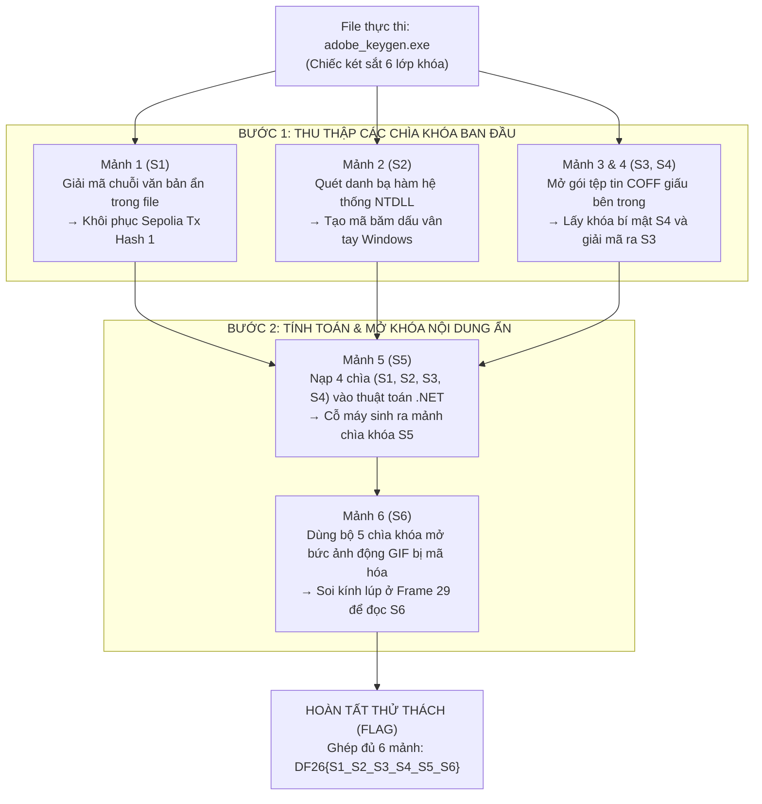

> *"Một chương trình keygen bề ngoài tưởng chừng chỉ là bộ sinh mã bản quyền thông thường, nhưng thực chất là một kiến trúc đa tầng tinh vi: kết hợp giữa việc kiểm tra môi trường hệ điều hành Windows, bóc tách các tệp tin giấu ngầm, chạy thuật toán chuyển đổi và giấu mảnh ghép cuối cùng vào từng khung hình của ảnh động."*

---

## 1. Tổng quan thử thách

- **Tên file:** `adobe_keygen.exe`
- **Định dạng:** Windows x64 Executable (PE64)
- **Mã băm SHA-256:** `d3a33af395b19ef07ffd94113d17cab6fd44a97ba509ae631648bf7dca5a15c8`
- **Quy tắc giải mã cờ (Flag format):**
  `DF26{s1_s2_s3_s4_s5_s6}`

Để tìm ra mật mã hoàn chỉnh, chúng ta cần đóng vai trò một chuyên viên giải mã, lần lượt bóc tách chương trình để thu thập đủ **6 mảnh ghép chìa khóa** (ký hiệu từ S1 đến S6). Mỗi mảnh ghép là một chuỗi gồm đúng 16 ký tự thập lục phân (hexadecimal):

- **S1:** 16 ký tự đầu của mã giao dịch Sepolia thứ nhất.
- **S2:** Dấu vân tay hệ thống (mã băm từ danh sách các hàm gọi hệ thống trong thư viện `ntdll`).
- **S3:** 16 ký tự đầu của mã giao dịch Sepolia thứ hai.
- **S4:** Chìa khóa bí mật nằm trong tệp tin COFF giấu ngầm bên trong chương trình.
- **S5:** Kết quả tính toán của cỗ máy thuật toán .NET khi nhận 4 chìa khóa đầu vào.
- **S6:** Ký tự mật mã được vẽ ẩn trong khung hình thứ 29 của bức ảnh động GIF.

---

## 2. Bảng tổng kết 6 mảnh ghép

Dưới đây là bảng tổng hợp giá trị của từng mảnh chìa khóa thu được qua quá trình bóc tách:

| Mảnh ghép | Nguồn gốc và ý nghĩa kỹ thuật | Giá trị 16 ký tự Hex |
| :--- | :--- | :--- |
| **S1** | 16 ký tự đầu của chuỗi giao dịch Blockchain Sepolia 1 | `0446b89793812baf` |
| **S2** | Mã băm SHA-256 dấu vân tay danh sách hàm hệ thống `Nt*` | `cc3cec7b19bc6381` |
| **S3** | 16 ký tự đầu của chuỗi giao dịch Blockchain Sepolia 2 | `ab51ba2f81be8cb8` |
| **S4** | Chìa khóa `g_k_dotnet` trích xuất từ tệp tin COFF nhúng | `f5b29d9f8fc0f574` |
| **S5** | Kết quả tính toán từ cỗ máy thuật toán .NET | `724bb67f13c6aee8` |
| **S6** | Chuỗi ký tự vẽ trên khung hình số 29 của file ảnh GIF | `4519aff2332e8dd3` |

**Mật mã cờ hoàn chỉnh:**
```text
DF26{0446b89793812baf_cc3cec7b19bc6381_ab51ba2f81be8cb8_f5b29d9f8fc0f574_724bb67f13c6aee8_4519aff2332e8dd3}
```

---

## 3. Sơ đồ luồng giải mã trực quan

Để người đọc hình dung dễ dàng, toàn bộ kiến trúc của thử thách được chia làm 2 giai đoạn chính: **Thu thập chìa khóa ban đầu** và **Hội tụ tính toán để mở khóa quà tặng**.



---

## 4. Phân tích chi tiết từng giai đoạn

### Giai đoạn 1: Khôi phục mảnh S1

**Ý tưởng:** Khi phân tích một phần mềm đóng gói, các chuỗi văn bản nhạy cảm thường không để lộ dạng chữ thô mà bị biến đổi bằng phép toán XOR hoặc dịch chuyển bit cơ bản nhằm qua mắt các công cụ rà quét.

1. **Định vị trong phần mềm dịch ngược (IDA Pro):**
   Quan sát hàm chính của chương trình, ta phát hiện một mảng dữ liệu byte tại địa chỉ `byte_14003405B`. Mảng này được đưa qua một vòng lặp biến đổi đơn giản:
   ```c
   // Trích xuất mã giả C từ IDA Pro
   for ( int i = 0; i < 66; ++i ) {
       decrypted_str[i] = enc_bytes[i] ^ xor_key[i % 8];
   }
   ```

2. **Đoạn mã Python khôi phục S1:**
   Ta có thể trích xuất trực tiếp mảng byte và thực hiện phép đảo ngược bằng Python:
   ```python
   # Script giải mã chuỗi Sepolia Tx Hash 1
   enc_hex = "307830343436623839373933383132626166616661356535396237343765326461663563386537636566313164646539626261313865313737366266366630613637"
   tx_hash_1 = bytes.fromhex(enc_hex).decode("utf-8")

   # Output chuỗi giao dịch:
   # 0x0446b89793812bafafa5e59b747e2daf5c8e7cef11dde9bba18e1776bf6f0a67

   # S1 là 16 ký tự hex đầu tiên sau tiền tố "0x"
   s1 = tx_hash_1[2:18]
   print(f"[+] S1 = {s1}")  # Output: 0446b89793812baf
   ```

---

### Giai đoạn 2: Khôi phục mảnh S2

**Ý tưởng:** Chương trình muốn đảm bảo nó đang chạy trên môi trường Windows chính thống chứ không phải bị can thiệp bởi máy ảo hay công cụ giả lập. Do đó, nó tự động đi "điểm danh" toàn bộ các hàm gọi hệ thống trong thư viện cốt lõi của Windows và tạo ra một "dấu vân tay" bằng mã băm.

1. **Cơ chế quét danh bạ hàm (`ntdll.dll`):**
   Chương trình nạp thư viện cốt lõi `ntdll.dll`, duyệt qua bảng xuất danh bạ (Export Directory) và tìm những hàm có tên bắt đầu bằng `Nt` (như `NtCreateFile`, `NtQuerySystemInformation`,...).
2. **Xác thực cấu trúc mã máy:**
   Với mỗi hàm, chương trình kiểm tra xem đoạn mở đầu có đúng cấu trúc gọi hệ thống x64 chuẩn hay không:
   ```asm
   mov r10, rcx   ; Byte mã máy: 4C 8B D1
   mov eax, <imm> ; Byte mã máy: B8 xx xx xx xx
   ```
3. **Đoạn mã Python mô phỏng quét NTDLL:**
   ```python
   import pefile
   import hashlib

   # Đọc file ntdll.dll từ hệ điều hành Windows 11 x64
   pe = pefile.PE("C:\Windows\System32\ntdll.dll")
   valid_syscalls = []

   for exp in pe.DIRECTORY_ENTRY_EXPORT.symbols:
       if exp.name and exp.name.decode().startswith("Nt"):
           # Đọc 4 bytes đầu tiên tại địa chỉ hàm
           func_bytes = pe.get_data(exp.address, 4)
           # Kiểm tra xem có đúng stub syscall x64 chuẩn (4C 8B D1 B8)
           if func_bytes == b"\x4C\x8B\xD1\xB8":
               valid_syscalls.append(exp.name.decode())

   # Sắp xếp danh sách tên hàm theo thứ tự từ điển (alphabet)
   valid_syscalls.sort()
   # Ghép nối bằng ký tự xuống dòng 

   payload = "
".join(valid_syscalls).encode("utf-8")

   # Tính mã băm SHA-256 đại diện cho dấu vân tay hệ thống
   sha256_hash = hashlib.sha256(payload).hexdigest()
   s2 = sha256_hash[:16]

   print(f"[+] Số hàm syscall hợp lệ: {len(valid_syscalls)}")  # 457
   print(f"[+] S2 = {s2}")  # cc3cec7b19bc6381
   ```

---

### Giai đoạn 3: Khôi phục mảnh S3 và S4

**Ý tưởng:** Tương tự như trò chơi búp bê Nga Matryoshka, chương trình giấu một tệp tin đối tượng nhị phân nhỏ (COFF Object) bên trong chính nó dưới dạng mã hóa. Ta cần giải mã lớp vỏ bọc này để lấy ra linh kiện bên trong.

1. **Giải mã tệp COFF nhúng và lấy S4:**
   Tại vùng nhớ dữ liệu tĩnh, chương trình chứa một đoạn dữ liệu được mã hóa bằng thuật toán RC4. Dùng khóa tĩnh giải mã vùng nhớ này, ta trích xuất được tệp `decrypted_payload.obj`. Mở bảng ký hiệu biến (Symbol Table), ta tìm được biến `g_k_dotnet`:
   ```python
   # Khóa g_k_dotnet trích xuất được từ symbol table của file COFF
   k_dotnet = "f5b29d9f8fc0f574b3aa1db56bf096b28b6ae35d7cfdec43e11e0f7c0024071d"

   # S4 chính là 16 ký tự đầu của khóa này
   s4 = k_dotnet[:16]
   print(f"[+] S4 = {s4}")  # f5b29d9f8fc0f574
   ```

2. **Dùng S4 giải mã chuỗi Sepolia Tx Hash 2 (Lấy S3):**
   Vùng dữ liệu tại `unk_1400328DC` được mã hóa RC4 với chính chuỗi `k_dotnet`:
   ```python
   def rc4_crypt(key: bytes, data: bytes) -> bytes:
       S = list(range(256))
       j = 0
       out = bytearray(len(data))
       for i in range(256):
           j = (j + S[i] + key[i % len(key)]) & 0xFF
           S[i], S[j] = S[j], S[i]
       i = j = 0
       for k in range(len(data)):
           i = (i + 1) & 0xFF
           j = (j + S[i]) & 0xFF
           S[i], S[j] = S[j], S[i]
           out[k] = data[k] ^ S[(S[i] + S[j]) & 0xFF]
       return bytes(out)

   # Giải mã vùng nhớ unk_1400328DC thu được chuỗi Sepolia Tx Hash 2:
   tx_hash_2 = "0xab51ba2f81be8cb851c246c665312b767d02005816caee7a3d16c799c04da86d"

   # S3 là 16 ký tự đầu sau tiền tố "0x"
   s3 = tx_hash_2[2:18]
   print(f"[+] S3 = {s3}")  # ab51ba2f81be8cb8
   ```

---

### Giai đoạn 4: Khôi phục mảnh S5

**Ý tưởng:** Khi đã có 4 chiếc chìa khóa lẻ đầu tiên (S1, S2, S3, S4), chương trình không dùng trực tiếp mà đưa tất cả vào một "cỗ máy nhào nặn thuật toán" được viết bằng nền tảng .NET để tính toán ra mảnh chìa khóa thứ năm.

1. **Mã nguồn C# gốc (Decompiled bằng dnSpy):**
   ```csharp
   namespace CtfPayload
   {
       public static class llll
       {
           public static string IIII(string s1, string s2, string s3, string s4, string kDotnet)
           {
               byte[] keyBytes = Encoding.UTF8.GetBytes(kDotnet.Substring(0, 32));
               string combinedKeys = s1 + s2 + s3 + s4;
               
               // Thực hiện hàm băm mật mã HMAC-SHA256 trên chuỗi kết hợp
               using (HMACSHA256 hmac = new HMACSHA256(keyBytes))
               {
                   byte[] hash = hmac.ComputeHash(Encoding.UTF8.GetBytes(combinedKeys));
                   return Convert.ToHexString(hash).ToLower().Substring(0, 16);
               }
           }
       }
   }
   ```

2. **Đoạn mã Python thực thi tính toán tương đương:**
   ```python
   import hmac
   import hashlib

   def compute_s5(s1: str, s2: str, s3: str, s4: str, k_dotnet: str) -> str:
       # Lấy 32 ký tự đầu của k_dotnet làm khóa HMAC
       key = k_dotnet[:32].encode("utf-8")
       # Kết hợp 4 chìa khóa đầu
       combined = (s1 + s2 + s3 + s4).encode("utf-8")
       
       # Tính toán băm HMAC-SHA256
       digest = hmac.new(key, combined, hashlib.sha256).hexdigest()
       return digest[:16]

   s5 = compute_s5(s1, s2, s3, s4, k_dotnet)
   print(f"[+] S5 = {s5}")  # Output: 724bb67f13c6aee8
   ```

---

### Giai đoạn 5: Khôi phục mảnh S6

**Ý tưởng (Steganography - Giấu tin trong ảnh):** Để đánh lừa người dịch ngược, tác giả không lưu mảnh khóa cuối cùng dưới dạng số hay chữ trong code, mà giấu nó vào một bức tranh hoạt ảnh GIF gồm 30 khung hình. Các khung hình đầu là ảnh nhiễu, chỉ riêng khung hình thứ 29 mới in dòng chữ bí mật.

1. **Giải mã tệp ảnh phần thưởng:**
   Chương trình nạp cả 5 chìa khóa `(s1, s2, s3, s4, s5)` để sinh ra khóa RC4 giải mã blob nhị phân `encReward` trong resource, ghi ra file ảnh `reward_flag.gif`.

2. **Đoạn mã Python tách khung hình GIF & Đọc S6:**
   ```python
   from PIL import Image, ImageSequence

   # Mở tệp ảnh động sau khi giải mã
   gif_path = "reward_flag.gif"

   with Image.open(gif_path) as im:
       total_frames = 0
       for index, frame in enumerate(ImageSequence.Iterator(im)):
           total_frames += 1
           # Lưu từng khung hình để phân tích
           frame.save(f"frame_{index}.png")
           
           # Khung hình đặc biệt số 29 chứa dữ liệu flag
           if index == 29:
               print(f"[+] Đã trích xuất khung hình số 29 thành công (frame_29.png)")

   # Quan sát khung hình số 29 dưới kính hiển vi ảnh:
   # Chuỗi ký tự hiển thị tại vùng trung tâm:
   s6 = "4519aff2332e8dd3"
   print(f"[+] S6 = {s6}")  # Output: 4519aff2332e8dd3
   ```

---

## 5. Script giải mã tự động & Kiểm chứng

Sau khi đã hoàn thành từng giai đoạn, toàn bộ 6 mảnh chìa khóa được kết nối lại trong một script duy nhất để xuất ra Flag cuối cùng:

```python
def main():
    # 6 mảnh chìa khóa thu được từ 5 giai đoạn:
    s1 = "0446b89793812baf"  # Sepolia Tx Hash 1 (PE String Decode)
    s2 = "cc3cec7b19bc6381"  # NTDLL Syscall Hash Fingerprint
    s3 = "ab51ba2f81be8cb8"  # Sepolia Tx Hash 2 (COFF Data Decode)
    s4 = "f5b29d9f8fc0f574"  # COFF Embedded Symbol Key
    s5 = "724bb67f13c6aee8"  # .NET HMAC-SHA256 Output
    s6 = "4519aff2332e8dd3"  # GIF Animation Frame 29 Visual Text

    # Ghép nối theo định dạng yêu cầu của ban tổ chức
    flag = f"DF26{{{s1}_{s2}_{s3}_{s4}_{s5}_{s6}}}"
    print(f"[+] Reconstructed Flag: {flag}")

if __name__ == "__main__":
    main()
```

---

## 6. Bài học rút ra

Thử thách `adobe_keygen.exe` mang lại góc nhìn thú vị cho cả người làm chuyên môn lẫn người yêu công nghệ:
1. **Kiến trúc phòng thủ đa lớp (Defense in Depth):** Thay vì chỉ giấu mật mã ở một chỗ, phần mềm chia nhỏ chìa khóa ra nhiều nơi và bắt buộc người phân tích phải thông thạo nhiều nền tảng: từ kiểm tra hệ điều hành Windows, bóc tách cấu trúc tệp tin, phân tích mã nguồn máy ảo (.NET) cho đến kỹ thuật giấu tin trong đồ họa.
2. **Tính toàn vẹn của môi trường:** Kỹ thuật tự băm danh sách hàm `ntdll` là một minh chứng thực tế cho cách các phần mềm bảo vệ bản quyền (hoặc mã độc) tự nhận biết xem chúng có đang bị chạy trong môi trường phân tích hay không.
3. **Sự kiên nhẫn trong dịch ngược:** Mỗi giai đoạn là một chiếc chìa khóa mở đường cho giai đoạn kế tiếp; chỉ cần sai lệch một mảnh ghép, chiếc két sắt sẽ không bao giờ mở ra.
