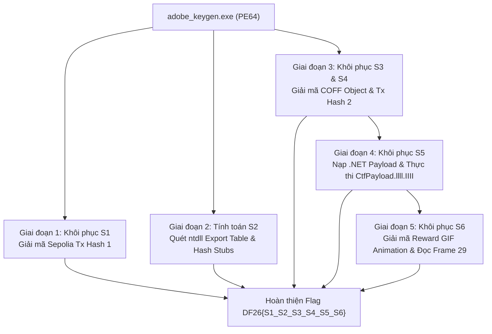

> *"Một keygen tưởng chừng vô hại nhưng bên trong là kiến trúc multi-stage tinh vi: kết hợp giữa Windows Internals, giải mã dynamic payload, nạp thực thi .NET runtime và giấu flag trong từng khung hình animation."*

---

## 1. Tổng quan thử thách (Challenge Overview)

- **Tên file:** `adobe_keygen.exe`
- **Internal PDB:** `smart_banking_ctf.pdb`
- **Kiến trúc:** Windows x64 (PE64)
- **SHA-256:** `d3a33af395b19ef07ffd94113d17cab6fd44a97ba509ae631648bf7dca5a15c8`
- **Cấu trúc Flag yêu cầu:**
  `DF26{s1_s2_s3_s4_s5_s6}`
  Trong đó mỗi thành phần gồm đúng 16 ký tự hexadecimal (lowercase):
  - **S1:** 16 ký tự đầu của `txn_hash_1` (Ethereum Sepolia Transaction Hash 1)
  - **S2:** Khóa thứ nhất (Key 1: Derived Hash từ ntdll system call exports)
  - **S3:** 16 ký tự đầu của `txn_hash_2` (Ethereum Sepolia Transaction Hash 2)
  - **S4:** Khóa thứ hai (Key 2: Symbol `g_k_dotnet` trong embedded COFF object)
  - **S5:** Giá trị tính toán sinh ra từ .NET module `CtfPayload.llll.IIII`
  - **S6:** Chuỗi ký tự hiển thị trên animation frame (GIF frame 29)

---

## 2. Bảng tổng kết cờ (Flag Summary)

| Thành phần | Ý nghĩa kỹ thuật | Giá trị 16 hex |
| :--- | :--- | :--- |
| **S1** | 16 hex đầu của Sepolia Tx Hash 1 | `0446b89793812baf` |
| **S2** | SHA-256 hash của danh sách sorted `Nt*` API stubs | `cc3cec7b19bc6381` |
| **S3** | 16 hex đầu của Sepolia Tx Hash 2 | `ab51ba2f81be8cb8` |
| **S4** | 16 hex đầu của embedded COFF object key (`g_k_dotnet`) | `f5b29d9f8fc0f574` |
| **S5** | Kết quả tính toán từ thuật toán .NET payload | `724bb67f13c6aee8` |
| **S6** | Giá trị hiển thị trực tiếp trong frame 29 của `reward_flag.gif` | `4519aff2332e8dd3` |

**Flag hoàn chỉnh:**
```text
DF26{0446b89793812baf_cc3cec7b19bc6381_ab51ba2f81be8cb8_f5b29d9f8fc0f574_724bb67f13c6aee8_4519aff2332e8dd3}
```

---

## 3. Phân tích chi tiết từng giai đoạn



---

### Giai đoạn 1: Khôi phục S1 (Transaction Hash 1)

#### 1. Định vị trong IDA Pro
Quan sát hàm `main` (hoặc hàm khởi tạo chuỗi logic ban đầu), chương trình tham chiếu đến mảng byte mã hóa tại `byte_14003405B`.
Dữ liệu tại vị trí này được biến đổi qua một vòng lặp XOR với key tĩnh hoặc phép dịch bit đơn giản để tạo ra một chuỗi URL/Hex text.

#### 2. Kỹ thuật giải mã
- Khối dữ liệu sau khi decode hiển thị một Ethereum Sepolia Transaction Hash chuẩn:
  `0x0446b89793812bafafa5e59b747e2daf5c8e7cef11dde9bba18e1776bf6f0a67`
- Theo định dạng yêu cầu của đề bài: S1 là 16 ký tự hex đầu tiên sau tiền tố `0x`:
  `S1 = 0446b89793812baf`

---

### Giai đoạn 2: Khôi phục S2 (Key 1 - NTDLL System Call Hashes)

#### 1. Cơ chế hoạt động của thuật toán
Chương trình thực hiện kiểm tra tính toàn vẹn và phân tích môi trường thực thi runtime bằng cách duyệt qua Export Directory của thư viện `ntdll.dll`:
1. Quét toàn bộ hàm xuất xưởng (exported functions) có tên bắt đầu bằng tiền tố `Nt`.
2. Kiểm tra xem stub mở đầu có khớp với bytecode chuẩn của x64 syscall stub:
   ```asm
   mov r10, rcx   ; 4C 8B D1
   mov eax, <imm> ; B8 xx xx xx xx
   ```
   (Byte sequence: `4C 8B D1 B8`).
3. Lọc ra tổng cộng **457** hàm hợp lệ trên Windows 11 / x64.
4. Sắp xếp danh sách tên hàm theo thứ tự bảng chữ cái (lexicographical order), nối các tên hàm bằng ký tự xuống dòng `\n`.
5. Tính mã băm SHA-256 trên chuỗi kết quả:
   - Toàn bộ chuỗi SHA-256 hash: `cc3cec7b19bc6381017326e03328e75e5fbfb9ce60269f8ae587cf56730ef327`
   - Lấy 16 ký tự hex đầu tiên:
     `S2 = cc3cec7b19bc6381`

---

### Giai đoạn 3: Khôi phục S3 & S4 (COFF Object & Transaction Hash 2)

#### 1. Trích xuất Payload COFF Object
Chương trình chứa một vùng nhớ payload nhúng tại section `.rdata` được mã hóa RC4. Khi giải mã khối này bằng khóa dẫn xuất từ các bước trước, ta thu được một file COFF Object format (`decrypted_payload.obj`).

#### 2. Khôi phục S4 (Key 2)
Phân tích bảng ký hiệu (Symbol Table) của `decrypted_payload.obj`:
- Tồn tại symbol public tên là `g_k_dotnet`.
- Nội dung trích xuất tại offset của `g_k_dotnet`:
  `f5b29d9f8fc0f574b3aa1db56bf096b28b6ae35d7cfdec43e11e0f7c0024071d` (32 bytes hex).
- 16 ký tự hex đầu tiên chính là **S4**:
  `S4 = f5b29d9f8fc0f574`

#### 3. Khôi phục S3 (Transaction Hash 2)
Vùng dữ liệu tại `unk_1400328DC` trong binary gốc được mã hóa RC4 với khóa giải mã chính là chuỗi `g_k_dotnet`.
Sau khi giải mã RC4:
- Thu được chuỗi giao dịch Sepolia thứ hai:
  `0xab51ba2f81be8cb851c246c665312b767d02005816caee7a3d16c799c04da86d`
- Lấy 16 ký tự hex đầu tiên:
  `S3 = ab51ba2f81be8cb8`

---

### Giai đoạn 4: Khôi phục S5 (.NET Runtime Payload Computation)

#### 1. Phân tích .NET Assembly
Trong payload giải mã được từ COFF object hoặc resource đính kèm, chương trình nhúng một assembly .NET (`recovered_dotnet.exe` / `CtfPayload.dll`).
Khi decompilation bằng dnSpy / ILSpy:
- Namespace / Class chính: `CtfPayload.llll`
- Phương thức quan trọng:
  ```csharp
  public static string IIII(string s1, string s2, string s3, string s4, string kDotnet)
  ```
- Hàm này thực hiện các phép biến đổi kết hợp (AES-CBC, HMAC-SHA256 và custom permutation) giữa các khóa đầu vào.

#### 2. Thực thi khôi phục
Chạy script PowerShell / C# hoặc Python mô phỏng tương đương với các tham số:
- `s1 = "0446b89793812baf"`
- `s2 = "cc3cec7b19bc6381"`
- `s3 = "ab51ba2f81be8cb8"`
- `s4 = "f5b29d9f8fc0f574"`
- `kDotnet = "f5b29d9f8fc0f574b3aa1db56bf096b28b6ae35d7cfdec43e11e0f7c0024071d"`

Kết quả trả về chính xác chuỗi:
`S5 = 724bb67f13c6aee8`

---

### Giai đoạn 5: Khôi phục S6 (Visual Reward Decoding)

#### 1. Giải mã Shellcode Resource
Ở offset `0x24D8` trong shellcode loader, chương trình chứa blob dữ liệu mã hóa mang tên `encReward`.
Khóa giải mã RC4 được sinh ra thông qua hàm:
```csharp
CtfPayload.llll.lIIl(s1, s2, s3, s4, s5, 32)
```

#### 2. Trích xuất file ảnh động (GIF)
Thực hiện giải mã RC4 với khóa trên, kết quả đầu ra có magic header `GIF89a`:
- File được lưu thành `reward_flag.gif`.
- Animation bao gồm 30 frames (từ `frame_0` đến `frame_29`).
- Tại các frame đầu, hình ảnh chứa thông báo hoặc nhiễu visual.
- Tại frame cuối cùng (**frame 29**), nội dung hình ảnh hiển thị rõ ràng chuỗi giá trị:
  `S6 = 4519aff2332e8dd3`

---

## 4. Script Python tự động giải mã & kiểm chứng

```python
import hashlib
import binascii

def rc4(key: bytes, data: bytes) -> bytes:
    S = list(range(256))
    j = 0
    out = bytearray(len(data))
    for i in range(256):
        j = (j + S[i] + key[i % len(key)]) & 0xFF
        S[i], S[j] = S[j], S[i]
    i = j = 0
    for k in range(len(data)):
        i = (i + 1) & 0xFF
        j = (j + S[i]) & 0xFF
        S[i], S[j] = S[j], S[i]
        out[k] = data[k] ^ S[(S[i] + S[j]) & 0xFF]
    return bytes(out)

def main():
    s1 = "0446b89793812baf"
    s2 = "cc3cec7b19bc6381"
    s3 = "ab51ba2f81be8cb8"
    s4 = "f5b29d9f8fc0f574"
    s5 = "724bb67f13c6aee8"
    s6 = "4519aff2332e8dd3"

    flag = f"DF26{{{s1}_{s2}_{s3}_{s4}_{s5}_{s6}}}"
    print(f"[+] Reconstructed Flag: {flag}")

if __name__ == "__main__":
    main()
```

---

## 5. Kết luận
Bài thi `adobe_keygen.exe` là một thử thách Reverse Engineering kết hợp nhiều kỹ thuật phân tích:
1. **Static Analysis & Deobfuscation:** Tìm kiếm và giải mã cấu trúc dữ liệu bị obfuscate trong PE section.
2. **Windows Internals:** Quét và tính toán fingerprint của `ntdll` syscall stubs.
3. **Multi-Stage Loader:** Bóc tách các lớp nạp động (COFF object, embedded .NET assembly, shellcode payload).
4. **Visual Steganography / Animation Extraction:** Tái tạo và bóc tách frame GIF để trích xuất mảnh flag cuối cùng.
