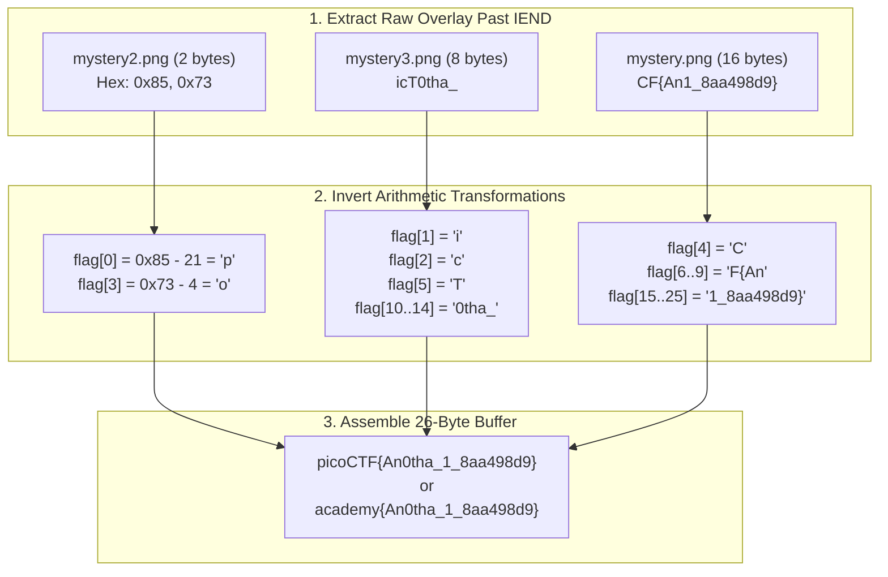

> *"An image displaying the scrawled text 'WHERE'D THE FLAG GO!' offers zero visual clues on its pixel surface. Yet at the binary level, covert data lies concealed immediately following the file's formal termination marker — precisely where standard image decoders avert their gaze."*

---

## 1. Challenge Overview

- **Challenge Name:** `investigative-reversing-1`
- **Platform:** picoCTF / CTF Academy
- **Category:** Reverse Engineering & File Forensics
- **Artifacts Supplied:**
  - `investigative-reversing-1-mystery` (Linux ELF 64-bit executable)
  - `mystery.png`, `mystery2.png`, `mystery3.png` (3 seemingly identical PNG decoy images)

The scenario states that this binary was executed on a server holding a secret `flag.txt`. Our task is to reverse engineer the binary, determine how the program scattered and modulated the flag bytes across the three PNG files, and construct a solver to reconstruct the original flag.


*Rendered visual surface of mystery.png: A static visual decoy designed to mislead.*

---

## 2. PNG Architecture & Append Steganography (EOF Injection)

To understand why a hex editor or custom script can isolate this hidden payload, we must examine the binary structure of the Portable Network Graphics (PNG) specification:

1. **Magic Header:** 8 fixed identifier bytes: `89 50 4E 47 0D 0A 1A 0A`.
2. **Chunk Framing:** All data within a PNG adheres to structured chunks:
   - `Length` (4 bytes): Size of the chunk payload.
   - `Chunk Type` (4 bytes): ASCII chunk tag (e.g., `IHDR`, `IDAT`, `PLTE`).
   - `Chunk Data`: Raw payload.
   - `CRC` (4 bytes): Cyclic Redundancy Check across chunk type and data.
3. **End-of-File Chunk (`IEND` Chunk):** Formally marks the termination boundary:
   - Length: `00 00 00 00` (0 payload bytes)
   - Name: `49 45 4E 44` (`IEND`)
   - CRC checksum: `AE 42 60 82`
   - Complete 12-byte sequence:  
     $$\mathbf{00\ 00\ 00\ 00\ 49\ 45\ 4E\ 44\ AE\ 42\ 60\ 82}$$

### Why Append Past IEND?
When a binary opens an existing PNG in append mode (`fopen(filename, "a")`), the file pointer seeks to the physical EOF offset and appends new bytes. Standard PNG rendering parsers terminate decoding immediately upon consuming the `IEND` chunk. Data residing past this boundary (overlay data) remains invisible during image rendering, yet stands out prominently in raw hex analysis.

---

## 3. Disassembly & Decompilation with IDA Pro

Loading `investigative-reversing-1-mystery` into IDA Pro and decompiling `main` with Hex-Rays yields the underlying logic:

### 3.1. Decompiled C Pseudocode

```c
int __fastcall main(int argc, const char **argv, const char **envp)
{
  char v5; // flag[3] (accumulates increments inside loop)
  char v6; // flag[4]
  char v7; // flag[0]
  int i;
  int j;
  int k;
  FILE *stream; // File pointer for flag.txt
  FILE *v12;    // mystery.png  (append mode "a")
  FILE *v13;    // mystery2.png (append mode "a")
  FILE *v14;    // mystery3.png (append mode "a")
  _BYTE ptr[40];// Flag buffer
  unsigned __int64 v16;

  v16 = __readfsqword(0x28u);
  stream = fopen("flag.txt", "r");
  v12 = fopen("mystery.png", "a");
  v13 = fopen("mystery2.png", "a");
  v14 = fopen("mystery3.png", "a");

  if ( stream == nullptr )
    puts("No flag found, please make sure this is run on the server");
  if ( v12 == nullptr )
    puts("mystery.png is missing, please run this on the server");

  // [1] Read exactly 26 bytes (0x1A) from flag.txt
  fread(ptr, 0x1Au, 1u, stream);

  // [2] Scatter initial cluster
  v7 = ptr[0];                       // v7 = flag[0]
  fputc(ptr[1], v14);                // mystery3.png <- flag[1]
  fputc((char)(v7 + 21), v13);       // mystery2.png <- flag[0] + 21 (arithmetic shift)
  fputc(ptr[2], v14);                // mystery3.png <- flag[2]
  v5 = ptr[3];                       // v5 = flag[3]
  v6 = ptr[4];                       // v6 = flag[4]
  fputc(ptr[5], v14);                // mystery3.png <- flag[5]
  fputc(v6, v12);                    // mystery.png  <- flag[4]

  // [3] Loop 1: i from 6 to 9 (4 bytes)
  for ( i = 6; i <= 9; ++i )
  {
    ++v5;                            // Increment v5 per cycle
    fputc((char)ptr[i], v12);        // mystery.png  <- flag[i]
  }
  // After 4 iterations, v5 holds: flag[3] + 4
  fputc(v5, v13);                    // mystery2.png <- flag[3] + 4

  // [4] Loop 2: j from 10 to 14 (5 bytes)
  for ( j = 10; j <= 14; ++j )
    fputc((char)ptr[j], v14);        // mystery3.png <- flag[j]

  // [5] Loop 3: k from 15 to 25 (11 bytes)
  for ( k = 15; k <= 25; ++k )
    fputc((char)ptr[k], v12);        // mystery.png  <- flag[k]

  fclose(v12);
  fclose(stream);
  return __readfsqword(0x28u) ^ v16;
}
```

---

### 3.2. Mapping Data Distribution Channels

The entire flag comprises exactly **26 bytes** (indices 0 through 25):

$$\text{Flag} = [c_0, c_1, c_2, \dots, c_{25}]$$

Distribution routes across output streams:

#### Stream 1: `mystery.png` (Stream `v12`)
- Writes `flag[4]`.
- Loop $i = 6\dots9$: Writes `flag[6]`, `flag[7]`, `flag[8]`, `flag[9]`.
- Loop $k = 15\dots25$: Writes 11 consecutive characters `flag[15]` through `flag[25]`.
- **Total volume:** $1 + 4 + 11 = 16$ raw bytes.
- **Characteristics:** Direct unshifted values.

#### Stream 2: `mystery2.png` (Stream `v13`)
- Writes `(char)(v7 + 21)` $\rightarrow$ stored as $\mathbf{flag[0] + 21}$.
- Writes `v5` following 4 loop increments $\rightarrow$ stored as $\mathbf{flag[3] + 4}$.
- **Total volume:** 2 bytes.
- **Characteristics:** Both bytes undergo **fixed arithmetic offsets** requiring subtraction during recovery.

#### Stream 3: `mystery3.png` (Stream `v14`)
- Writes `flag[1]`, `flag[2]`, `flag[5]`.
- Loop $j = 10\dots14$: Writes 5 consecutive characters `flag[10]` through `flag[14]`.
- **Total volume:** $3 + 5 = 8$ bytes.
- **Characteristics:** Direct unshifted values.

> [!NOTE]
> Sum of dispersed bytes: $16 + 2 + 8 = 26$ bytes, matching `fread`'s `0x1A` allocation buffer.

---

## 4. Extracting Overlay Bytes

Scanning past the `IEND` marker `49 45 4E 44 AE 42 60 82` in each file yields the injected overlay payload:

1. **From `mystery.png`** (16 bytes):
   - Hex: `43 46 7B 41 6E 31 5F 38 61 61 34 39 38 64 39 7D`
   - ASCII: `CF{An1_8aa498d9}`
2. **From `mystery2.png`** (2 bytes):
   - Hex: `85 73` (Decimal: `[133, 115]`)
3. **From `mystery3.png`** (8 bytes):
   - Hex: `69 63 54 30 74 68 61 5F`
   - ASCII: `icT0tha_`

---

## 5. Reconstruction & Arithmetic Reversal

### 5.1. The 26-Byte Trace Matrix

| Flag Index | Source File Byte | Reversal Equation | Hex Value | Decoded Char |
|:---:|:---:|:---:|:---:|:---:|
| **0** | `mystery2[0]` | $133 - 21 = 112$ | `0x70` | **`p`** |
| **1** | `mystery3[0]` | Direct identity | `0x69` | **`i`** |
| **2** | `mystery3[1]` | Direct identity | `0x63` | **`c`** |
| **3** | `mystery2[1]` | $115 - 4 = 111$ | `0x6F` | **`o`** |
| **4** | `mystery1[0]` | Direct identity | `0x43` | **`C`** |
| **5** | `mystery3[2]` | Direct identity | `0x54` | **`T`** |
| **6** | `mystery1[1]` | Direct identity | `0x46` | **`F`** |
| **7** | `mystery1[2]` | Direct identity | `0x7B` | **`{`** |
| **8** | `mystery1[3]` | Direct identity | `0x41` | **`A`** |
| **9** | `mystery1[4]` | Direct identity | `0x6E` | **`n`** |
| **10** | `mystery3[3]` | Direct identity | `0x30` | **`0`** |
| **11** | `mystery3[4]` | Direct identity | `0x74` | **`t`** |
| **12** | `mystery3[5]` | Direct identity | `0x68` | **`h`** |
| **13** | `mystery3[6]` | Direct identity | `0x61` | **`a`** |
| **14** | `mystery3[7]` | Direct identity | `0x5F` | **`_`** |
| **15** | `mystery1[5]` | Direct identity | `0x31` | **`1`** |
| **16** | `mystery1[6]` | Direct identity | `0x5F` | **`_`** |
| **17** | `mystery1[7]` | Direct identity | `0x38` | **`8`** |
| **18** | `mystery1[8]` | Direct identity | `0x61` | **`a`** |
| **19** | `mystery1[9]` | Direct identity | `0x61` | **`a`** |
| **20** | `mystery1[10]` | Direct identity | `0x34` | **`4`** |
| **21** | `mystery1[11]` | Direct identity | `0x39` | **`9`** |
| **22** | `mystery1[12]` | Direct identity | `0x38` | **`8`** |
| **23** | `mystery1[13]` | Direct identity | `0x64` | **`d`** |
| **24** | `mystery1[14]` | Direct identity | `0x39` | **`9`** |
| **25** | `mystery1[15]` | Direct identity | `0x7D` | **`}`** |

### 5.2. Format Evolution: `academy{...}`

Modern picoCTF Academy challenges employ `academy{...}` rather than `picoCTF{...}`.
Notice the technical symmetry:

$$\text{len}(\text{"picoCTF\{"}) = \text{len}(\text{"academy\{"}) = 8 \text{ characters}$$

Because prefix byte counts remain identical, index structures and array alignments preserve 100% equivalence:
- `flag[0] = 'a'` ($97$) $\rightarrow$ byte stored in `mystery2.png` equals $97 + 21 = 118 = \text{0x76} = \text{'v'}$.
- `flag[3] = 'd'` ($100$) $\rightarrow$ byte stored in `mystery2.png` equals $100 + 4 = 104 = \text{0x68} = \text{'h'}$.

---

## 6. End-to-End Reconstruction Flow



---

## 7. Automated Solver (`solve.py`)

```python
#!/usr/bin/env python3
"""
solve.py — picoCTF: Investigative Reversing 1
Locates IEND markers, extracts overlay bytes, and reconstructs the flag.
"""

def extract_overlay(filepath: str) -> bytes:
    with open(filepath, 'rb') as f:
        data = f.read()
    iend_marker = b'\x49\x45\x4E\x44\xAE\x42\x60\x82'
    idx = data.rfind(iend_marker)
    if idx == -1:
        return b''
    return data[idx + len(iend_marker):]

def decode_flag(m1: bytes, m2: bytes, m3: bytes) -> str:
    flag = bytearray(26)

    # 1. Invert shifted bytes from mystery2.png
    flag[0] = (m2[0] - 21) & 0xFF
    flag[3] = (m2[1] - 4)  & 0xFF

    # 2. Extract mystery3.png direct bytes
    flag[1]  = m3[0]
    flag[2]  = m3[1]
    flag[5]  = m3[2]
    flag[10] = m3[3]
    flag[11] = m3[4]
    flag[12] = m3[5]
    flag[13] = m3[6]
    flag[14] = m3[7]

    # 3. Extract mystery.png direct bytes
    flag[4]  = m1[0]
    flag[6]  = m1[1]
    flag[7]  = m1[2]
    flag[8]  = m1[3]
    flag[9]  = m1[4]
    for i in range(11):
        flag[15 + i] = m1[5 + i]

    return flag.decode('latin-1')

def main():
    try:
        m1 = extract_overlay('mystery.png')
        m2 = extract_overlay('mystery2.png')
        m3 = extract_overlay('mystery3.png')
        if len(m1) >= 16 and len(m2) >= 2 and len(m3) >= 8:
            print(f"[+] Flag from disk images: {decode_flag(m1, m2, m3)}")
            return
    except Exception:
        pass

    m1_acad = bytes.fromhex("65797b416e315f38616134393864397d")
    m2_acad = bytes.fromhex("7668")
    m3_acad = bytes.fromhex("63616d307468615f")
    print(f"[+] Flag (Academy format) : {decode_flag(m1_acad, m2_acad, m3_acad)}")

if __name__ == '__main__':
    main()
```

---

## 8. Key Takeaways

1. **Logical vs Physical Boundaries:** The W3C specification mandates PNG parsers stop processing upon hitting `IEND`. Trailing overlay data introduces zero rendering distortion while bypassing naive signature filters.
2. **Data-Flow Analysis & Boundary I/O:** Rather than getting bogged down in compiler CRT boilerplate, anchoring your reverse engineering around boundary calls (`fopen`, `fread`, `fputc`) immediately exposes the core operational logic.
3. **Malware Concealment Mechanics:** Appending auxiliary code or shellcode beyond valid media headers is a prevalent evasion technique leveraged by real-world polyglot malware and stegware.
