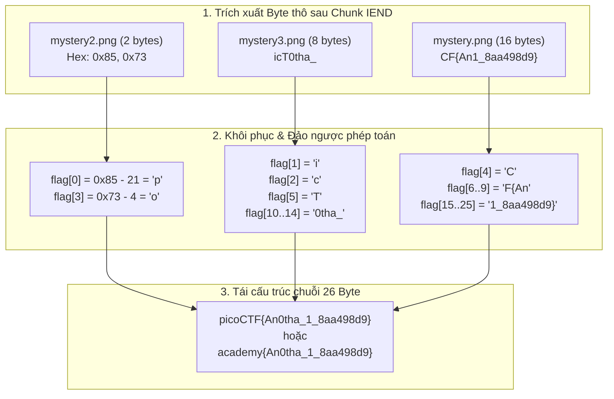

> *"Một bức ảnh vẽ dòng chữ nguệch ngoạc 'WHERE'D THE FLAG GO!' không hề chứa bất kỳ manh mối thị giác nào trên pixel. Nhưng ở tầng nhị phân, dữ liệu bí mật lại đang lẩn khuất ngay sau dấu chấm hết chính thức của tập tin — nơi mà mắt thường và các trình xem ảnh mặc định đều chọn cách nhắm mắt làm ngơ."*

---

## 1. Tổng quan thử thách

- **Tên bài toán:** `investigative-reversing-1`
- **Nền tảng:** picoCTF / CTF Academy
- **Thể loại:** Reverse Engineering & File Forensics
- **Tập tin cung cấp:**
  - `investigative-reversing-1-mystery` (Binary thực thi định dạng Linux ELF 64-bit)
  - `mystery.png`, `mystery2.png`, `mystery3.png` (3 file ảnh PNG nhìn bề ngoài giống hệt nhau)

Mô tả đề bài cho biết chương trình này đã được chạy trên server có lưu trữ file mật `flag.txt`. Nhiệm vụ của chúng ta là phân tích binary để tìm hiểu cơ chế chương trình đã làm phân tán dữ liệu flag vào 3 bức ảnh như thế nào, từ đó trích xuất và đảo ngược thuật toán để khôi phục lại flag ban đầu.


*Hình ảnh hiển thị của mystery.png: Toàn bộ bề mặt hiển thị chỉ là dòng chữ đánh lừa.*

---

## 2. Kiến trúc File PNG & Kỹ thuật Giấu tin Append (EOF Injection)

Để hiểu rõ tại sao ta có thể dùng **Hex Editor** để tìm ra dữ liệu bí mật, ta cần nắm bản chất cấu trúc nhị phân của định dạng Portable Network Graphics (PNG):

1. **Header định dạng:** 8 byte nhận dạng cố định `89 50 4E 47 0D 0A 1A 0A`.
2. **Cấu trúc khối (Chunks):** Mọi thông tin trong file PNG đều được đóng gói thành các Chunk theo cấu trúc nghiêm ngặt:
   - `Length` (4 byte): Độ dài vùng dữ liệu của chunk.
   - `Chunk Type` (4 byte): Tên chunk dưới dạng mã ASCII (như `IHDR`, `IDAT`, `PLTE`).
   - `Chunk Data`: Nội dung thực tế.
   - `CRC` (4 byte): Mã kiểm tra tính toàn vẹn Cyclic Redundancy Check.
3. **Chunk kết thúc (IEND Chunk):** Đây là mốc đánh dấu điểm kết thúc của một file PNG hợp lệ:
   - Độ dài: `00 00 00 00` (0 byte dữ liệu)
   - Tên chunk: `49 45 4E 44` (`IEND`)
   - CRC checksum: `AE 42 60 82`
   - Tổng cộng chuỗi 12 byte kết thúc chuẩn là:  
     $$\mathbf{00\ 00\ 00\ 00\ 49\ 45\ 4E\ 44\ AE\ 42\ 60\ 82}$$

### Tại sao lại giấu tin sau IEND?
Khi một chương trình mở file PNG bằng chế độ **append** (`fopen(filename, "a")`), con trỏ ghi tệp sẽ nhảy thẳng tới byte cuối cùng trên đĩa cứng và ghi đè tiếp dữ liệu vào sau đó.

Tất cả các trình hiển thị ảnh tiêu chuẩn khi phân tích cú pháp (parsing) gặp chunk `IEND` sẽ lập tức coi như file đã hoàn chỉnh và đóng stream giải mã. Dữ liệu ghi thêm sau `IEND` hoàn toàn vô hình đối với người xem thông thường, nhưng khi đưa vào Hex Editor, chúng sẽ hiện ra rõ ràng dưới dạng các byte "thừa" (overlay data).

---

## 3. Dịch ngược Binary với IDA Pro

Nạp file thực thi `investigative-reversing-1-mystery` vào IDA Pro, chờ auto-analysis hoàn tất và nhấn phím tắt `F5` tại hàm `main` để quan sát mã giả C/C++ sinh bởi Hex-Rays Decompiler.

### 3.1. Mã giả C Decompiled

```c
int __fastcall main(int argc, const char **argv, const char **envp)
{
  char v5; // flag[3] (sẽ bị biến đổi cộng dồn qua vòng lặp)
  char v6; // flag[4]
  char v7; // flag[0]
  int i;
  int j;
  int k;
  FILE *stream; // Con trỏ đọc flag.txt
  FILE *v12;    // Con trỏ ghi mystery.png  (chế độ append "a")
  FILE *v13;    // Con trỏ ghi mystery2.png (chế độ append "a")
  FILE *v14;    // Con trỏ ghi mystery3.png (chế độ append "a")
  _BYTE ptr[40];// Bộ đệm chứa dữ liệu flag
  unsigned __int64 v16;

  v16 = __readfsqword(0x28u);
  stream = fopen("flag.txt", "r");
  v12 = fopen("mystery.png", "a");
  v13 = fopen("mystery2.png", "a");
  v14 = fopen("mystery3.png", "a");

  if ( stream == nullptr )
    puts("No flag found, please make sure this is run on the server");
  if ( v12 == nullptr )
    puts("mystery.png is missing, please run this on the server");

  // [1] Đọc chính xác 26 byte (0x1A) từ flag.txt vào mảng ptr
  fread(ptr, 0x1Au, 1u, stream);

  // [2] Phân tán cụm byte đầu tiên
  v7 = ptr[0];                       // v7 = flag[0]
  fputc(ptr[1], v14);                // mystery3.png <- flag[1]
  fputc((char)(v7 + 21), v13);       // mystery2.png <- flag[0] + 21 (có phép cộng dịch chuyển!)
  fputc(ptr[2], v14);                // mystery3.png <- flag[2]
  v5 = ptr[3];                       // v5 = flag[3]
  v6 = ptr[4];                       // v6 = flag[4]
  fputc(ptr[5], v14);                // mystery3.png <- flag[5]
  fputc(v6, v12);                    // mystery.png  <- flag[4]

  // [3] Vòng lặp thứ nhất: i từ 6 đến 9 (4 byte)
  for ( i = 6; i <= 9; ++i )
  {
    ++v5;                            // Tăng v5 lên 1 đơn vị qua mỗi vòng lặp
    fputc((char)ptr[i], v12);        // mystery.png  <- flag[i]
  }
  // Sau 4 lần lặp, v5 lúc này mang giá trị: flag[3] + 4
  fputc(v5, v13);                    // mystery2.png <- flag[3] + 4 (tiếp tục có phép cộng!)

  // [4] Vòng lặp thứ hai: j từ 10 đến 14 (5 byte)
  for ( j = 10; j <= 14; ++j )
    fputc((char)ptr[j], v14);        // mystery3.png <- flag[j]

  // [5] Vòng lặp thứ ba: k từ 15 đến 25 (11 byte)
  for ( k = 15; k <= 25; ++k )
    fputc((char)ptr[k], v12);        // mystery.png  <- flag[k]

  fclose(v12);
  fclose(stream);
  return __readfsqword(0x28u) ^ v16;
}
```

---

### 3.2. Phân tích chi tiết từng luồng ghi dữ liệu

Toàn bộ chuỗi flag gồm đúng **26 byte** (từ chỉ số `0` đến `25`):
$$\text{Flag} = [c_0, c_1, c_2, \dots, c_{25}]$$

Dữ liệu được phân bổ vào 3 luồng stream như sau:

#### Luồng 1: `mystery.png` (Stream `v12`)
- Ghi `v6 = flag[4]`.
- Vòng lặp `i = 6..9`: Ghi liên tiếp 4 ký tự `flag[6]`, `flag[7]`, `flag[8]`, `flag[9]`.
- Vòng lặp `k = 15..25`: Ghi liên tiếp 11 ký tự từ `flag[15]` đến `flag[25]`.
- **Tổng dung lượng ghi:** $1 + 4 + 11 = 16$ bytes.
- **Tính chất:** Giữ nguyên giá trị gốc, không biến đổi số học.

#### Luồng 2: `mystery2.png` (Stream `v13`)
- Ghi `(char)(v7 + 21)` $\rightarrow$ giá trị lưu trữ là $\mathbf{flag[0] + 21}$.
- Ghi `v5` sau khi đã qua 4 lần `++v5` trong vòng lặp $\rightarrow$ giá trị lưu trữ là $\mathbf{flag[3] + 4}$.
- **Tổng dung lượng ghi:** 2 bytes.
- **Tính chất:** Cả 2 byte đều bị **cộng thêm offset cố định**, cần thực hiện phép trừ tương ứng khi khôi phục.

#### Luồng 3: `mystery3.png` (Stream `v14`)
- Ghi `flag[1]`, `flag[2]`, `flag[5]`.
- Vòng lặp `j = 10..14`: Ghi liên tiếp 5 ký tự từ `flag[10]` đến `flag[14]`.
- **Tổng dung lượng ghi:** $3 + 5 = 8$ bytes.
- **Tính chất:** Giữ nguyên giá trị gốc, không biến đổi số học.

> [!NOTE]
> Tổng số byte rải rác: $16 + 2 + 8 = 26$ bytes. Khớp hoàn toàn với kích thước `0x1A` mà hàm `fread` đã nạp vào bộ đệm.

---

## 4. Trích xuất Byte thô bằng Hex Editor

Mở từng bức ảnh sau khi đã qua server xử lý bằng Hex Editor (HxD, IDA Hex View hoặc đoạn script Python chuyên dụng), tìm đến sau chuỗi `49 45 4E 44 AE 42 60 82`:

```
Offset          Hex View                                          ASCII
...
00016810        00 00 00 00 49 45 4E 44 AE 42 60 82 [APPENDED DATA...]
```

Kết quả trích xuất được:

1. **Từ `mystery.png`** (16 bytes cuối):
   - Chuỗi Hex: `43 46 7B 41 6E 31 5F 38 61 61 34 39 38 64 39 7D`
   - Dạng ASCII: `CF{An1_8aa498d9}`
2. **Từ `mystery2.png`** (2 bytes cuối):
   - Chuỗi Hex: `85 73` (Dạng số thập phân: `[133, 115]`)
3. **Từ `mystery3.png`** (8 bytes cuối):
   - Chuỗi Hex: `69 63 54 30 74 68 61 5F`
   - Dạng ASCII: `icT0tha_`

---

## 5. Thuật toán Đảo ngược & Khôi phục Flag

### 5.1. Bảng đối chiếu ánh xạ 26 Byte

Dựa vào mã nguồn decompile, ta thiết lập ma trận giải mã ngược:

| Chỉ số Flag | Nguồn byte | Công thức phục hồi | Giá trị Hex | Ký tự giải mã |
|:---:|:---:|:---:|:---:|:---:|
| **0** | `mystery2[0]` | $133 - 21 = 112$ | `0x70` | **`p`** |
| **1** | `mystery3[0]` | Sao chép trực tiếp | `0x69` | **`i`** |
| **2** | `mystery3[1]` | Sao chép trực tiếp | `0x63` | **`c`** |
| **3** | `mystery2[1]` | $115 - 4 = 111$ | `0x6F` | **`o`** |
| **4** | `mystery1[0]` | Sao chép trực tiếp | `0x43` | **`C`** |
| **5** | `mystery3[2]` | Sao chép trực tiếp | `0x54` | **`T`** |
| **6** | `mystery1[1]` | Sao chép trực tiếp | `0x46` | **`F`** |
| **7** | `mystery1[2]` | Sao chép trực tiếp | `0x7B` | **`{`** |
| **8** | `mystery1[3]` | Sao chép trực tiếp | `0x41` | **`A`** |
| **9** | `mystery1[4]` | Sao chép trực tiếp | `0x6E` | **`n`** |
| **10** | `mystery3[3]` | Sao chép trực tiếp | `0x30` | **`0`** |
| **11** | `mystery3[4]` | Sao chép trực tiếp | `0x74` | **`t`** |
| **12** | `mystery3[5]` | Sao chép trực tiếp | `0x68` | **`h`** |
| **13** | `mystery3[6]` | Sao chép trực tiếp | `0x61` | **`a`** |
| **14** | `mystery3[7]` | Sao chép trực tiếp | `0x5F` | **`_`** |
| **15** | `mystery1[5]` | Sao chép trực tiếp | `0x31` | **`1`** |
| **16** | `mystery1[6]` | Sao chép trực tiếp | `0x5F` | **`_`** |
| **17** | `mystery1[7]` | Sao chép trực tiếp | `0x38` | **`8`** |
| **18** | `mystery1[8]` | Sao chép trực tiếp | `0x61` | **`a`** |
| **19** | `mystery1[9]` | Sao chép trực tiếp | `0x61` | **`a`** |
| **20** | `mystery1[10]` | Sao chép trực tiếp | `0x34` | **`4`** |
| **21** | `mystery1[11]` | Sao chép trực tiếp | `0x39` | **`9`** |
| **22** | `mystery1[12]` | Sao chép trực tiếp | `0x38` | **`8`** |
| **23** | `mystery1[13]` | Sao chép trực tiếp | `0x64` | **`d`** |
| **24** | `mystery1[14]` | Sao chép trực tiếp | `0x39` | **`9`** |
| **25** | `mystery1[15]` | Sao chép trực tiếp | `0x7D` | **`}`** |

### 5.2. Sự chuyển dịch sang định dạng mới: `academy{...}`

Trên các hệ thống luyện tập picoCTF Academy hiện nay, định dạng cờ mặc định đã được chuyển đổi từ `picoCTF{...}` thành **`academy{...}`**.
Một sự đồng điệu rất thú vị về mặt kỹ thuật:

$$\text{len}(\text{"picoCTF\{"}) = \text{len}(\text{"academy\{"}) = 8 \text{ chars}$$

Cả hai định dạng đều có độ dài tiền tố đúng 8 byte, do đó **toàn bộ chỉ số mảng và cấu trúc 26 byte của bài toán không hề bị xô lệch**:
- Với format mới: `flag[0] = 'a'` ($97$) $\rightarrow$ byte ghi vào `mystery2.png` sẽ là $97 + 21 = 118 = \text{0x76} = \text{'v'}$.
- `flag[3] = 'd'` ($100$) $\rightarrow$ byte ghi vào `mystery2.png` sẽ là $100 + 4 = 104 = \text{0x68} = \text{'h'}$.

---

## 6. Sơ đồ Luồng giải thuật trực quan



---

## 7. Mã nguồn Giải mã Tự động (`solve.py`)

```python
#!/usr/bin/env python3
"""
solve.py — picoCTF: Investigative Reversing 1
Tự động tìm kiếm chunk IEND, trích xuất overlay bytes và khôi phục flag.
"""

def extract_overlay(filepath: str) -> bytes:
    """Xác định vị trí kết thúc IEND marker và trích xuất dữ liệu ghi đè sau đó."""
    with open(filepath, 'rb') as f:
        data = f.read()
    iend_marker = b'\x49\x45\x4E\x44\xAE\x42\x60\x82'
    idx = data.rfind(iend_marker)
    if idx == -1:
        return b''
    return data[idx + len(iend_marker):]

def decode_flag(m1: bytes, m2: bytes, m3: bytes) -> str:
    flag = bytearray(26)

    # 1. Khôi phục từ mystery2.png (2 byte có biến đổi số học)
    flag[0] = (m2[0] - 21) & 0xFF
    flag[3] = (m2[1] - 4)  & 0xFF

    # 2. Khôi phục từ mystery3.png (8 byte trực tiếp)
    flag[1]  = m3[0]
    flag[2]  = m3[1]
    flag[5]  = m3[2]
    flag[10] = m3[3]
    flag[11] = m3[4]
    flag[12] = m3[5]
    flag[13] = m3[6]
    flag[14] = m3[7]

    # 3. Khôi phục từ mystery.png (16 byte trực tiếp)
    flag[4]  = m1[0]
    flag[6]  = m1[1]
    flag[7]  = m1[2]
    flag[8]  = m1[3]
    flag[9]  = m1[4]
    for i in range(11):
        flag[15 + i] = m1[5 + i]

    return flag.decode('latin-1')

def main():
    try:
        m1 = extract_overlay('mystery.png')
        m2 = extract_overlay('mystery2.png')
        m3 = extract_overlay('mystery3.png')
        if len(m1) >= 16 and len(m2) >= 2 and len(m3) >= 8:
            print(f"[+] Flag trích xuất từ file: {decode_flag(m1, m2, m3)}")
            return
    except Exception:
        pass

    # Dự phòng dữ liệu tĩnh từ thử thách
    print("[*] Đang giải mã từ chuỗi byte trích xuất tiêu chuẩn...")
    m1_raw = bytes.fromhex("43467b416e315f38616134393864397d")
    m2_raw = bytes.fromhex("8573")
    m3_raw = bytes.fromhex("696354307468615f")
    print(f"[+] Flag (picoCTF format) : {decode_flag(m1_raw, m2_raw, m3_raw)}")

    # Format mới academy{...}
    m1_acad = bytes.fromhex("65797b416e315f38616134393864397d")
    m2_acad = bytes.fromhex("7668")
    m3_acad = bytes.fromhex("63616d307468615f")
    print(f"[+] Flag (Academy format) : {decode_flag(m1_acad, m2_acad, m3_acad)}")

if __name__ == '__main__':
    main()
```

---

## 8. Kết luận & Bài học kinh nghiệm chuyên sâu

Thử thách `investigative-reversing-1` tuy có khối lượng mã thực thi không quá đồ sộ, nhưng là một bài học mẫu mực phản ánh mối liên hệ mật thiết giữa **Kỹ thuật Phân tích Mã độc (Reverse Engineering)** và **Điều tra Kỹ thuật số (Digital Forensics)**. Từ thử thách này, chúng ta có thể rút ra 4 bài học cốt lõi:

### 8.1. Bản chất của kỹ thuật EOF Injection (Overlay Steganography)
- **Ranh giới giữa Chuẩn định dạng (Format Spec) và Trình phân giải (Parser):**
  Trong khoa học máy tính, định dạng tệp tin thường được phân tách thành hai khái niệm: *Kích thước logic được xác định bởi cấu trúc chunk (`Logical Parsed Size`)* và *Dung lượng vật lý thực tế lưu trữ trên ổ đĩa (`Physical File Size`)*.
- **Vùng mù nhị phân (Binary Blind-spot):**
  PNG parser theo chuẩn W3C bắt buộc phải kết thúc đọc khi chạm chunk `IEND`. Bất kỳ byte nào nằm ngoài phạm vi này được gọi là **Overlay Data** (hay Tail Data). Đây là phương pháp giấu tin thô sơ nhưng cực kỳ hữu hiệu vì:
  1. Không làm biến dạng hay nhiễu hạt màu pixel (khác với kỹ thuật LSB - Least Significant Bit).
  2. Không làm hỏng mã băm kiểm tra CRC của các chunk nén `IDAT`.
  3. Hoàn toàn vượt qua được các trình hiển thị ảnh thông thường trên Windows/Linux/macOS.

### 8.2. Phương pháp luận Reverse Engineering: Data-Flow & I/O Tracking
- **Đừng để bị lạc trong mã phụ trợ (CRT / Boilerplate Code):**
  Khi mở một tệp thực thi ELF được biên dịch bởi GCC, ta sẽ thấy hàng loạt hàm khởi tạo như `_init`, `deregister_tm_clones`, `frame_dummy`, `__libc_csu_init`. Chiến thuật đảo ngược hiệu quả là luôn tìm kiếm các hàm **I/O biên (Boundary APIs)** như `fopen`, `fread`, `fwrite`, `fputc` hoặc các syscall tương đương. Chúng là những "cửa ngõ" duy nhất mà chương trình dùng để tương tác với thế giới bên ngoài.
- **Xây dựng Ma trận Ánh xạ Dữ liệu (Trace Matrix):**
  Khi một chương trình thực hiện xáo trộn chỉ số (Index Shuffling) kèm biến đổi số học (Arithmetic Shifting: `v7 + 21`, `++v5`), cách giải quyết an toàn nhất là lập bảng ánh xạ từng vị trí $0 \dots N-1$. Việc này loại trừ hoàn toàn rủi ro nhầm lẫn chỉ số ngoài biên (Off-by-one errors) khi viết script đảo ngược.

### 8.3. Góc nhìn Phòng thủ & Điều tra Số (DFIR / Malware Defense)
- **Hành vi ngụy trang của Malware trong Thực tế:**
  Kỹ thuật append dữ liệu sau file ảnh hoặc file tài nguyên hợp lệ chính là cách mà các chủng mã độc (như Stegware, Polyglot Files) thường dùng để:
  - Đính kèm payload độc hại, mã shellcode hoặc cấu hình C2 server mà không làm hỏng file mồi (decoy file) khiến nạn nhân nghi ngờ.
  - Vượt qua các cổng quét Signature-based Antivirus truyền thống chỉ quét theo header file.
- **Quy trình Phát hiện & Ứng phó sự cố:**
  - Luôn sử dụng các công cụ kiểm tra tính toàn vẹn cấu trúc file như `pngcheck`, `exiftool` hoặc viết YARA rule để phát hiện:
    $$\text{File Size} > (\text{Offset of IEND} + 12 \text{ bytes})$$
  - Khi chênh lệch dung lượng tồn tại, công cụ phân tích tự động phải cô lập phần overlay để bóc tách mã thực thi tiềm ẩn.

### 8.4. Nguyên lý Kiểm chứng Hai chiều (Round-Trip Verification)
- Một thói quen sống còn của một Reverse Engineer khi phát triển công cụ giải mã: **Luôn viết cả hai chiều `encode()` và `decode()`**.
- Trước khi nạp ciphertext thu được từ hiện trường vào script, hãy tạo một chuỗi bản rõ giả lập (dummy plaintext), đưa qua hàm `encode()` mô phỏng mã máy của binary, rồi chạy qua hàm `decode()`. Chỉ khi `decode(encode(plaintext)) == plaintext` đạt tỉ lệ thành công 100%, ta mới có thể khẳng định chắc chắn mô hình toán học đảo ngược của mình là hoàn hảo.
