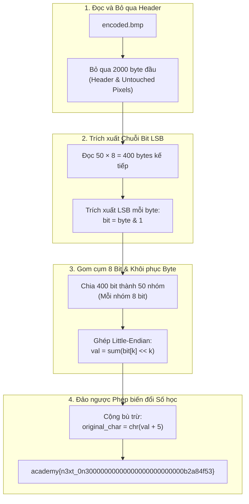

> *"Trong bảo mật nhị phân và điều tra số, kỹ thuật giấu tin (Steganography) không nhằm mục đích biến dữ liệu thành những khối mật mã khó hiểu, mà hướng tới việc che giấu chính sự tồn tại của thông điệp. Một bức ảnh bitmap tưởng chừng vô hại với hàng triệu pixel lại có thể trở thành kênh truyền bí mật (Covert Channel) hoàn hảo nếu biết tận dụng giới hạn thụ cảm thị giác của mắt người."*

---

## 1. Tổng quan thử thách

- **Tên bài toán:** `investigative-reversing-2`
- **Nền tảng:** picoCTF / CTF Academy
- **Thể loại:** Reverse Engineering & Digital Forensics
- **Tập tin cung cấp:**
  - `mystery` (Binary thực thi định dạng Linux ELF 64-bit)
  - `encoded.bmp` (File ảnh định dạng Windows Bitmap chứa dữ liệu đã mã hóa)

Ở phần 1 (`Investigative Reversing 1`), chúng ta đã chứng kiến phương pháp giấu tin thô sơ **EOF Injection (Overlay Append)** – ghi nối tiếp dữ liệu vào sau đuôi ảnh PNG. Sang phần 2, tác giả nâng cấp độ phức tạp bằng cách can thiệp trực tiếp vào cấu trúc hạt nhân của tệp ảnh: kỹ thuật **Least Significant Bit (LSB) Steganography** kết hợp thao tác bitwise và biến đổi số học trên từng ký tự.


*Hình ảnh hiển thị của encoded.bmp: Hoàn toàn bình thường, không hề có bất kỳ dấu hiệu biến dạng hay nhiễu màu mắt thường có thể nhìn thấy.*

---

## 2. Cấu trúc File BMP & Nguyên lý LSB Steganography

### 2.1. Giải phẫu tệp ảnh Bitmap (BMP)
Khác với PNG hay JPEG vốn sử dụng các thuật toán nén phức tạp (DEFLATE, Discrete Cosine Transform), định dạng **Windows Bitmap (BMP)** lưu trữ dữ liệu điểm ảnh dưới dạng thô (Raw Uncompressed Pixel Data):

1. **BITMAPFILEHEADER (14 bytes):** Chứa định danh `BM` (`0x4D42`), kích thước tệp và vị trí bắt đầu của mảng pixel (`bfOffBits`).
2. **BITMAPINFOHEADER / DIB Header (40 bytes trở lên):** Xác định chiều rộng (Width), chiều cao (Height), độ sâu màu (Bits Per Pixel - bpp).
3. **Color Table / Gap (tùy chọn):** Bảng màu hoặc khoảng trống căn lề.
4. **Pixel Array:** Mảng lưu trữ giá trị các kênh màu (thường là BGR - Blue, Green, Red) cho từng điểm ảnh.

> [!IMPORTANT]
> Trong hàm `main`, chương trình thực hiện copy nguyên vẹn **2000 byte đầu tiên** của ảnh gốc sang ảnh mới trước khi can thiệp dữ liệu. Khoảng 2000 byte này bao gồm toàn bộ Header, Metadata và một phần pixel ban đầu. Việc bỏ qua khoảng đệm này giúp bảo toàn tuyệt đối tính toàn vẹn của tệp BMP, ngăn chặn nguy cơ làm hỏng header khiến các trình đọc ảnh từ chối mở tệp.

### 2.2. Bản chất toán học của LSB Steganography
Mắt người có giới hạn về độ nhạy màu sắc (Just Noticeable Difference - JND). Mỗi byte biểu diễn cường độ màu nhận giá trị từ $0 \to 255$ (8 bit nhị phân):

$$\text{Byte} = b_7 b_6 b_5 b_4 b_3 b_2 b_1 b_0$$

- Bit $b_7$ là **MSB (Most Significant Bit)**: Mang trọng số $2^7 = 128$. Thay đổi bit này sẽ làm thay đổi màu sắc rõ rệt.
- Bit $b_0$ là **LSB (Least Significant Bit)**: Mang trọng số $2^0 = 1$. Việc thay đổi bit $b_0$ chỉ làm dịch chuyển giá trị độ sáng tối đa $\pm 1$ đơn vị ($\approx 0.39\%$), một độ lệch hoàn toàn vô hình trước thị giác con người.

Bằng cách thay thế bit $b_0$ của mỗi kênh màu bằng 1 bit bí mật, kẻ tấn công hoặc chương trình giấu tin có thể nhúng một thông điệp tùy ý vào tệp đa phương tiện.

---

## 3. Dịch ngược Binary với IDA Pro

Nạp tệp `mystery` vào IDA Pro 64-bit, chờ thanh trạng thái chuyển sang **AU: idle** và bấm phím tắt **`F5`** tại hàm `main`.

### 3.1. Mã giả C Decompiled (`main`)

```c
int __fastcall main(int argc, const char **argv, const char **envp)
{
  char ptr; 
  char v5; 
  int v6; 
  int i, j, k; 
  int v10, v11, v12; 
  FILE *v13;    // Con trỏ đọc flag.txt
  FILE *stream; // Con trỏ đọc original.bmp
  FILE *v15;    // Con trỏ ghi encoded.bmp (chế độ append "a")
  _BYTE v16[56];// Bộ đệm lưu trữ flag đọc từ flag.txt
  unsigned __int64 v17;

  v17 = __readfsqword(0x28u);
  v10 = 0;
  v13 = fopen("flag.txt", "r");
  stream = fopen("original.bmp", "r");
  v15 = fopen("encoded.bmp", "a");

  if ( v13 == nullptr )
    puts("No flag found, please make sure this is run on the server");
  if ( stream == nullptr )
    puts("original.bmp is missing, please run this on the server");

  v6 = fread(&ptr, 1u, 1u, stream);

  // [1] Sao chép nguyên vẹn 2000 byte đầu tiên của ảnh gốc
  v11 = 2000;
  for ( i = 0; i < v11; ++i )
  {
    fputc(ptr, v15);
    v6 = fread(&ptr, 1u, 1u, stream);
  }

  // [2] Đọc flag từ flag.txt (0x32 = 50 ký tự)
  v12 = fread(v16, 0x32u, 1u, v13);
  if ( v12 <= 0 )
  {
    puts("flag is not 50 chars");
    exit(0);
  }

  // [3] Nhúng 50 ký tự của flag vào luồng byte ảnh
  for ( j = 0; j <= 49; ++j )        // Duyệt 50 ký tự flag
  {
    for ( k = 0; k <= 7; ++k )       // Duyệt 8 bit cho mỗi ký tự
    {
      v5 = codedChar(k, v16[j] - 5, ptr);
      fputc(v5, v15);
      fread(&ptr, 1u, 1u, stream);
    }
  }

  // [4] Sao chép toàn bộ phần còn lại của ảnh gốc
  while ( v6 == 1 )
  {
    fputc(ptr, v15);
    v6 = fread(&ptr, 1u, 1u, stream);
  }

  fclose(v15);
  fclose(stream);
  fclose(v13);
  return 0;
}
```

> [!TIP]
> **Mẹo IDA Pro:** Khi mới decompile, IDA có thể hiển thị hằng số `v12 = fread(v16, 0x32u, 1u, v13);`. Bạn chỉ cần đặt con trỏ tại `0x32u` và nhấn phím **`H`**, IDA sẽ lập tức chuyển đổi sang hệ thập phân là `50`.

### 3.2. Mổ xẻ hàm con `codedChar`

Nhấp đúp vào hàm `codedChar`, mã giả thể hiện cốt lõi của giải thuật:

```c
__int64 __fastcall codedChar(int a1, char a2, char a3)
{
  char v4;

  v4 = a2;
  if ( a1 != 0 )
    v4 = a2 >> a1;
  return v4 & 1 | a3 & 0xFEu;
}
```

Ánh xạ tham số từ lời gọi `codedChar(k, v16[j] - 5, ptr)`:
- `a1 = k`: Chỉ số bit đang xử lý ($0 \le k \le 7$).
- `a2 = v16[j] - 5`: Ký tự thứ $j$ của flag sau khi đã **trừ đi 5**.
- `a3 = ptr`: Byte hiện tại của file ảnh gốc.

Phân tích từng phép toán bit:
1. `v4 = a2 >> a1`: Dịch phải ký tự `a2` đi `k` bit.
2. `v4 & 1`: Lấy giá trị của bit thứ `k` (kết quả là $0$ hoặc $1$).
3. `a3 & 0xFE`: Vì $\text{0xFE}_{16} = 11111110_2$, phép toán `AND` này sẽ xóa bit cuối cùng của byte ảnh gốc về `0` và giữ nguyên 7 bit cao.
4. `(v4 & 1) | (a3 & 0xFE)`: Ghi đè bit của flag vào vị trí LSB của byte ảnh.

> [!IMPORTANT]
> **Thứ tự bit (Bit-Order Convention):**
> Vòng lặp `k` chạy từ $0 \to 7$. Như vậy:
> - $k = 0$: Bit thứ $0$ (LSB) của ký tự được ghi vào byte ảnh đầu tiên.
> - $k = 7$: Bit thứ $7$ (MSB) của ký tự được ghi vào byte ảnh thứ 8.
> 
> Đây là quy ước **Little-Endian Bit Order**. Khi giải mã, ta bắt buộc phải khôi phục theo công thức:
> $$\text{char\_val} = \sum_{k=0}^{7} (\text{bit}_k \ll k)$$

---

## 4. Thiết kế Mô hình Toán học Đảo ngược (Reverse Pipeline)

Để khôi phục toàn bộ flag từ file `encoded.bmp`, quy trình giải mã hoàn toàn đối xứng qua 4 giai đoạn:



---

## 5. Khai thác & Khôi phục Tự động (`solve.py`)

Dưới đây là kịch bản Python hoàn chỉnh thực thi giải mã:

```python
#!/usr/bin/env python3
"""
solve.py — picoCTF: Investigative Reversing 2
Trích xuất dữ liệu giấu tin LSB Steganography trong tệp BMP và đảo ngược phép toán số học.
"""

def extract_flag(filename: str, flag_len: int = 50, header_offset: int = 2000) -> str:
    flag_bits = []
    
    with open(filename, "rb") as f:
        # 1. Bỏ qua 2000 byte header không đổi
        f.seek(header_offset)
        
        # 2. Đọc chính xác 50 * 8 = 400 byte chứa các bit nhúng của flag
        payload_bytes = f.read(flag_len * 8)
        if len(payload_bytes) < flag_len * 8:
            raise ValueError("Tệp ảnh không đủ kích thước dữ liệu cần thiết!")
            
        for byte in payload_bytes:
            # Lấy bit LSB (tương ứng phép & 1 trong binary)
            flag_bits.append(byte & 1)
            
    # 3. Tái cấu trúc từng ký tự từ các nhóm 8 bit (Little-Endian)
    flag = ""
    for i in range(0, len(flag_bits), 8):
        byte_bits = flag_bits[i:i+8]
        # Gom các bit theo trọng số bit 0 -> 7
        val = sum(bit << idx for idx, bit in enumerate(byte_bits))
        # Đảo ngược phép toán: mã hóa trừ 5 -> giải mã cộng 5
        flag += chr(val + 5)
        
    return flag

if __name__ == "__main__":
    target_file = "encoded.bmp"
    flag = extract_flag(target_file)
    print("=" * 60)
    print(f"[+] Flag thu được: {flag}")
    print(f"[+] Độ dài chuỗi : {len(flag)} ký tự")
    print("=" * 60)
```

### Kết quả thực thi
```text
============================================================
[+] Flag thu được: academy{n3xt_0n30000000000000000000000000b2a84f53}
[+] Độ dài chuỗi : 50 ký tự
============================================================
```

Flag hợp lệ có độ dài chính xác **50 ký tự** đúng như điều kiện kiểm tra `fread(v16, 0x32u, 1u, v13)` trong tệp nhị phân.

---

## 6. Phân tích Dưới Góc Nhìn Chuyên Gia An Toàn Thông Tin (Security Researcher Perspective)

### 6.1. Phương pháp phát hiện Steganalysis (DFIR)
Trong thực tế điều tra sự cố số, khi không có mã nguồn hoặc tệp thực thi của kẻ tấn công, làm thế nào để chuyên gia phát hiện ra một file BMP đang chứa dữ liệu LSB giấu tin?

1. **Kiểm tra Phân bố Tần suất Byte (Chi-Square Attack on PoVs):**
   Trong ảnh tự nhiên, tần số xuất hiện của các cặp giá trị chẵn/lẻ lân cận $(2k, 2k+1)$ (gọi là Pairs of Values - PoVs) thường không bằng nhau. Khi áp dụng LSB nhúng ngẫu nhiên, tần suất của $2k$ và $2k+1$ sẽ có xu hướng cân bằng tiệm cận. Sử dụng kiểm định $\chi^2$ (Chi-square test) trên từng khối byte của ảnh sẽ lập tức làm bộc lộ vùng dữ liệu bất thường từ offset `2000` đến `2400`.
2. **Kỹ thuật LSB Extraction Visualization:**
   Tạo ảnh mặt nạ bằng cách nhân giá trị bit 0 với 255: `pixel_mask = (pixel & 1) * 255`. Vùng ảnh bình thường sẽ có dạng nhiễu hạt ngẫu nhiên, trong khi vùng chứa dữ liệu văn bản/mật mã thường xuất hiện các dải hoa văn đồng nhất hoặc có cấu trúc bất thường.

### 6.2. Ứng dụng Thực tế Trong Chiến dịch Mã Độc Nâng Cao (APTs)
Kỹ thuật LSB Steganography trong BMP/PNG không chỉ xuất hiện trong các bài thi CTF mà từng được ghi nhận trong nhiều chiến dịch tấn công APT khét tiếng:
- **Stegoloader (Gatak):** Sử dụng các tệp ảnh kỹ thuật số định dạng BMP hoặc PNG để giấu các module mã độc PE payload chính. Chỉ khi được nạp vào bộ nhớ máy nạn nhân, mã độc mới tiến hành trích xuất LSB để giải mã payload thực thi.
- **OceanLotus (APT32):** Nhúng cấu hình C2 server và DLL độc hại vào ảnh BMP/ICO để vượt qua hệ thống giám sát cổng mạng (Next-Gen Firewall / IDS) và các phần mềm diệt virus kiểm tra chữ ký thông thường.

### 6.3. Giải pháp Phòng ngừa & Khắc phục
- **Triển khai Content Disarm and Reconstruction (CDR):** 
  Các cổng bảo mật nội dung mạng cần áp dụng giải pháp CDR: tự động phân giải ảnh, làm sạch hoặc tái nén (re-encode) sang định dạng khác trước khi chuyển đến người dùng cuối. Quá trình re-encode sẽ làm thay đổi cấu trúc pixel và phá hủy hoàn toàn các payload LSB ẩn giấu.
- **Giám sát Dung lượng & Bất thường Tệp:** 
  Cảnh báo bất thường đối với các tệp ảnh BMP có dung lượng lớn được truyền tải qua các giao thức web/mail không mã hóa ra các IP ngoại vi đáng ngờ.
