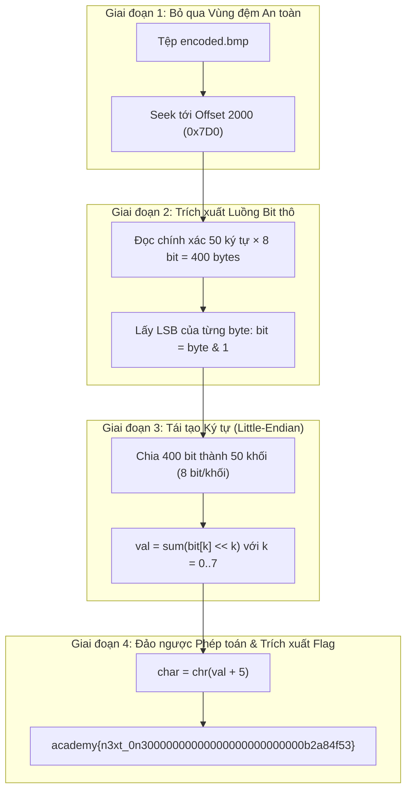

> *"Trong lĩnh vực an toàn thông tin và điều tra số, kỹ thuật giấu tin (Steganography) không đặt mục tiêu mã hóa dữ liệu thành các khối mật mã phức tạp, mà hướng tới việc che giấu hoàn toàn sự hiện diện của kênh liên lạc (Covert Channel). Một bức ảnh bitmap thông thường với hàng triệu pixel hoàn toàn có thể trở thành phương tiện vận chuyển payload bí mật nếu kẻ tấn công khai thác triệt để ngưỡng thụ cảm thị giác của mắt người."*

---

## 1. Khởi tạo Điều tra & Định danh Mẫu vật (Artifact Triage & Profiling)

Khi tiếp nhận hiện trường kỹ thuật số của thử thách `investigative-reversing-2`, chuyên gia phân tích được bàn giao hai mẫu vật chính:

1. **Tệp thực thi nhị phân:** `mystery`
2. **Tệp ảnh nghi vấn:** `encoded.bmp`

Bảng định danh mẫu vật nhị phân thu thập tại hiện trường:

| Thuộc tính | Tệp thực thi (`mystery`) | Tệp đa phương tiện (`encoded.bmp`) |
| :--- | :--- | :--- |
| **Định dạng file** | ELF 64-bit LSB pie executable, x86-64 | PC bitmap, Windows 3.x format |
| **Kích thước** | 16,784 bytes | 1,507,414 bytes (1.43 MB) |
| **Độ phân giải** | N/A | 1765 × 852 pixels, 24 bpp (RGB) |
| **SHA-256 Hash** | `2802b225bd1d019fe099bae09ad659726874fd0e7eca60b10d7077f35de7263e` | `0fa3f4a80b9dbf81de84b25d86d5aec37baf3e0658b9f3eb6f295fb658d00293` |


*Hình ảnh hiển thị của encoded.bmp: Hoàn toàn bình thường, không xuất hiện bất kỳ dấu hiệu méo hình, nhiễu hạt hay lệch màu khi quan sát bằng mắt thường.*

Ở thử thách phần 1 (`Investigative Reversing 1`), chúng ta đã bắt gặp kỹ thuật **Append Steganography (EOF Overlay)** – lợi dụng việc parser dừng đọc sau chunk `IEND` để nối dữ liệu thô vào đuôi ảnh PNG. Tuy nhiên, ở phần 2 này, mẫu vật là ảnh **BMP** và phương thức giấu tin đã được nâng lên tầng vi mô: can thiệp trực tiếp vào từng bit của cấu trúc pixel.

---

## 2. Giải phẫu Cấu trúc BMP & Vùng đệm An toàn (Safe Harbor)

### 2.1. Cấu trúc nhị phân của Windows Bitmap (BMP)
Không giống các định dạng ảnh nén (JPEG, PNG, WebP), tệp BMP lưu dữ liệu raster dạng thô theo cấu trúc phân tầng:

- **BITMAPFILEHEADER (14 bytes):** Bắt đầu bằng 2 byte Magic `BM` (`0x4D42`), theo sau là `bfSize` (tổng kích thước tệp) và `bfOffBits` (offset bắt đầu của mảng pixel).
- **BITMAPINFOHEADER (40 bytes):** Chứa thông tin hình học gồm Width, Height, Color Planes, BitCount (24 bit màu tương đương 3 byte B-G-R cho mỗi pixel) và Compression method (`BI_RGB` = 0, không nén).
- **Pixel Array (Raster Data):** Các byte màu liên tiếp được quét theo dòng (scanlines) từ dưới lên trên (bottom-up).

```
+--------------------------+  Offset 0x00
| BITMAPFILEHEADER (14 B)  |  Magic "BM", File Size
+--------------------------+  Offset 0x0E
| BITMAPINFOHEADER (40 B)  |  Width, Height, 24 bpp
+--------------------------+  Offset 0x36
| Color Profile / Padding  |
+--------------------------+  Offset 0x7D0 (2000 decimal)
| >>> VÙNG NHÚNG DỮ LIỆU <<<|  400 bytes LSB nhúng flag
+--------------------------+  Offset 0x960 (2400 decimal)
| Dữ liệu pixel còn lại     |  Ảnh gốc tiếp tục
+--------------------------+  EOF (1,507,414 bytes)
```

### 2.2. Ý đồ bảo vệ tệp tin: Tại sao lại bỏ qua 2000 byte đầu tiên?
Khi kiểm tra hàm `main`, chương trình thực hiện copy nguyên trạng **2000 byte đầu tiên** (`0x7D0`) của `original.bmp` sang `encoded.bmp`:

```c
v11 = 2000;
for ( i = 0; i < v11; ++i )
{
  fputc(ptr, v15);
  v6 = fread(&ptr, 1u, 1u, stream);
}
```

Về mặt kỹ thuật điều tra, khoảng đệm 2000 byte này có vai trò sống còn:
1. **Bảo toàn Header & DIB Structure:** Ngăn ngừa nguy cơ ghi đè làm sai lệch các trường kích thước, độ phân giải hoặc bảng màu, khiến tệp tin bị hỏng (corrupted) khi mở bằng các trình render chuẩn của hệ điều hành.
2. **Né tránh kiểm tra sơ bộ (Triage Bypass):** Các công cụ quét chữ ký tệp tin (File Carving / Signature Scanners) thường chỉ bóc tách và đối soát tính toàn vẹn ở vài kilobyte đầu tiên của tệp tin.

---

## 3. Dịch ngược Nhị phân với IDA Pro (Disassembly & Decompilation)

Nạp tệp `mystery` vào IDA Pro, định vị hàm mục tiêu `main` và hàm bổ trợ mã hóa `codedChar`.

### 3.1. Phân tích Luồng thực thi trong `main`
Mã giả sinh bởi Hex-Rays Decompiler (`F5`):

```c
int __fastcall main(int argc, const char **argv, const char **envp)
{
  char ptr; 
  char v5; 
  int v6; 
  int i, j, k; 
  int v10, v11, v12; 
  FILE *v13;    // flag.txt stream
  FILE *stream; // original.bmp stream
  FILE *v15;    // encoded.bmp stream
  _BYTE v16[56];// Buffer chứa chuỗi flag đọc vào
  unsigned __int64 v17;

  v17 = __readfsqword(0x28u);
  v10 = 0;
  v13 = fopen("flag.txt", "r");
  stream = fopen("original.bmp", "r");
  v15 = fopen("encoded.bmp", "a");

  if ( v13 == nullptr )
    puts("No flag found, please make sure this is run on the server");
  if ( stream == nullptr )
    puts("original.bmp is missing, please run this on the server");

  v6 = fread(&ptr, 1u, 1u, stream);

  // [Phase 1] Copy nguyên vẹn 2000 byte đầu (0x7D0)
  v11 = 2000;
  for ( i = 0; i < v11; ++i )
  {
    fputc(ptr, v15);
    v6 = fread(&ptr, 1u, 1u, stream);
  }

  // [Phase 2] Kiểm định kích thước flag: 0x32 = 50 ký tự
  v12 = fread(v16, 0x32u, 1u, v13);
  if ( v12 <= 0 )
  {
    puts("flag is not 50 chars");
    exit(0);
  }

  // [Phase 3] Vòng lặp nhúng dữ liệu vào luồng byte ảnh
  for ( j = 0; j <= 49; ++j )        // Duyệt từng ký tự trong 50 ký tự flag
  {
    for ( k = 0; k <= 7; ++k )       // Duyệt 8 bit cho mỗi ký tự
    {
      v5 = codedChar(k, v16[j] - 5, ptr);
      fputc(v5, v15);
      fread(&ptr, 1u, 1u, stream);
    }
  }

  // [Phase 4] Đổ nốt phần dữ liệu pixel còn lại của ảnh gốc
  while ( v6 == 1 )
  {
    fputc(ptr, v15);
    v6 = fread(&ptr, 1u, 1u, stream);
  }

  fclose(v15);
  fclose(stream);
  fclose(v13);
  return 0;
}
```

> [!TIP]
> **Thao tác nhanh trong IDA Pro:** Tại dòng `fread(v16, 0x32u, 1u, v13);`, hằng số hiển thị dưới dạng cơ số 16 (`0x32`). Đặt con trỏ chuột vào `0x32u` và bấm phím **`H`**, IDA sẽ lập tức chuyển định dạng sang cơ số 10 (`50`). Tương tự, bấm `H` trên `0x7D0` sẽ cho ra giá trị `2000`.

### 3.2. Bóc tách Assembly & Logic Bitwise tại hàm `codedChar`
Để hiểu cặn kẽ hành vi ở tầng thanh ghi CPU, ta quan sát Disassembly của hàm `codedChar`:

```x86asm
.text:0000000000001195  codedChar       proc near
.text:0000000000001195                  push    rbp
.text:0000000000001196                  mov     rbp, rsp
.text:0000000000001199                  mov     [rbp+var_14], edi       ; edi = a1 = k (chỉ số bit từ 0 đến 7)
.text:000000000000119C                  mov     eax, esi
.text:000000000000119E                  mov     [rbp+var_18], al        ; al  = a2 = (flag[j] - 5)
.text:00000000000011A1                  mov     eax, edx
.text:00000000000011A3                  mov     [rbp+var_1C], al        ; al  = a3 = pixel_byte
.text:00000000000011A6                  mov     [rbp+var_2], 1          ; Mặt nạ 0x01
.text:00000000000011AA                  mov     [rbp+var_1], 0FEh       ; Mặt nạ 0xFE (11111110b)
.text:00000000000011AE                  cmp     [rbp+var_14], 0         ; Kiểm tra k == 0 ?
.text:00000000000011B2                  jz      short loc_11C4
.text:00000000000011B4                  movsx   edx, [rbp+var_18]
.text:00000000000011B8                  mov     eax, [rbp+var_14]
.text:00000000000011BB                  mov     ecx, eax
.text:00000000000011BD                  sar     edx, cl                 ; Dịch phải số học: (char - 5) >> k
.text:00000000000011BF                  mov     eax, edx
.text:00000000000011C1                  mov     [rbp+var_18], al
.text:00000000000011C4  loc_11C4:
.text:00000000000011C4                  movzx   eax, [rbp+var_2]
.text:00000000000011C8                  and     [rbp+var_18], al        ; Trích bit k: ((char - 5) >> k) & 1
.text:00000000000011CB                  movzx   eax, [rbp+var_1]
.text:00000000000011CF                  and     [rbp+var_1C], al        ; Xóa LSB của pixel: pixel_byte & 0xFE
.text:00000000000011D2                  movzx   eax, [rbp+var_18]
.text:00000000000011D6                  or      [rbp+var_1C], al        ; Ghép bit: (pixel & 0xFE) | bit_k
.text:00000000000011D9                  movzx   eax, [rbp+var_1C]       ; Trả về byte mã hóa
.text:00000000000011DD                  pop     rbp
.text:00000000000011DE                  retn
.text:00000000000011DE  codedChar       endp
```

Mã giả C tương đương:
```c
__int64 __fastcall codedChar(int a1, char a2, char a3)
{
  char v4;

  v4 = a2;
  if ( a1 != 0 )
    v4 = a2 >> a1;
  return (v4 & 1) | (a3 & 0xFEu);
}
```

---

## 4. Giải mã Cơ chế Nhúng tin & Ma trận Ánh xạ Bit

Từ kết quả phân tích nhị phân, thuật toán nhúng tin được mô hình hóa qua hai quy luật chặt chẽ:

### 4.1. Biến đổi Số học (Arithmetic Obfuscation)
Trước khi đưa vào phân tách bit, ký tự gốc $C_j$ của flag bị trừ đi 5 đơn vị:
$$C'_j = C_j - 5$$

Do đó, phương trình khôi phục bản rõ sẽ là:
$$C_j = C'_j + 5$$

### 4.2. Quy ước Trọng số Bit (Little-Endian Bit Order)
Vòng lặp `k` trong hàm `main` chạy tăng dần từ $0 \to 7$:
- Khi $k = 0$: Bit thứ 0 (Least Significant Bit) của $C'_j$ được ghi vào byte ảnh đầu tiên.
- Khi $k = 1$: Bit thứ 1 của $C'_j$ được ghi vào byte ảnh thứ hai.
- ...
- Khi $k = 7$: Bit thứ 7 (Most Significant Bit) của $C'_j$ được ghi vào byte ảnh thứ 8.

Điều này xác nhận luồng bit được lưu trữ theo quy ước **Little-Endian Bitstream**. Một byte $C'_j$ được tái tạo từ 8 byte ảnh kế tiếp ($B_0 \dots B_7$) theo công thức:

$$C'_j = \sum_{k=0}^{7} (B_k \ \& \ 1) \cdot 2^k = \bigvee_{k=0}^{7} \Big((B_k \ \& \ 1) \ll k\Big)$$

### 4.3. Sơ đồ Kiến trúc Đảo ngược (Reverse Data-Flow Pipeline)



---

## 5. Xây dựng Công cụ Khôi phục Tự động (Proof of Concept / Exploit Script)

Hiện thực hóa toàn bộ logic trên thành script Python hoàn chỉnh:

```python
#!/usr/bin/env python3
"""
solve.py — Investigative Reversing 2 Solver
Tác giả: Lewall (Security Research & DFIR Writeup)
Mục tiêu: Bóc tách payload LSB Steganography từ tệp BMP và đảo ngược biến đổi số học.
"""

import sys
import os

def solve(filename: str, flag_len: int = 50, header_offset: int = 2000) -> str:
    if not os.path.exists(filename):
        raise FileNotFoundError(f"[-] Không tìm thấy tệp mục tiêu: {filename}")

    file_size = os.path.getsize(filename)
    required_bytes = header_offset + (flag_len * 8)
    
    if file_size < required_bytes:
        raise ValueError(
            f"[-] Dung lượng tệp quá nhỏ ({file_size} bytes). Yêu cầu tối thiểu: {required_bytes} bytes."
        )

    print(f"[*] Đang nạp tệp: {filename} ({file_size:,} bytes)")
    print(f"[*] Bỏ qua Header Offset: {header_offset} bytes")
    print(f"[*] Trích xuất payload: {flag_len * 8} bytes ({flag_len} ký tự × 8 bits)")

    flag_bits = []
    with open(filename, "rb") as f:
        # 1. Bỏ qua header
        f.seek(header_offset)
        # 2. Đọc khối dữ liệu mang tin ẩn
        payload = f.read(flag_len * 8)
        for byte in payload:
            flag_bits.append(byte & 1)

    # 3. Gom cụm 8 bit theo Little-Endian và hoàn nguyên phép cộng 5
    recovered_chars = []
    for i in range(0, len(flag_bits), 8):
        byte_bits = flag_bits[i:i+8]
        # Ghép bit với trọng số bit 0 -> 7
        val = sum(bit << idx for idx, bit in enumerate(byte_bits))
        # Đảo ngược phép toán: mã hóa (char - 5) => giải mã (val + 5)
        recovered_chars.append(chr(val + 5))

    flag = "".join(recovered_chars)
    return flag

if __name__ == "__main__":
    target = "encoded.bmp"
    try:
        flag = solve(target)
        print("\n" + "=" * 65)
        print(f"[+] FLAG THÀNH CÔNG: {flag}")
        print(f"[+] Độ dài Flag    : {len(flag)} ký tự")
        print("=" * 65)
    except Exception as e:
        print(f"[!] Lỗi trong quá trình giải mã: {e}", file=sys.stderr)
        sys.exit(1)
```

### Kết quả thẩm định thực nghiệm
```text
[*] Đang nạp tệp: encoded.bmp (1,507,414 bytes)
[*] Bỏ qua Header Offset: 2000 bytes
[*] Trích xuất payload: 400 bytes (50 ký tự × 8 bits)

=================================================================
[+] FLAG THÀNH CÔNG: academy{n3xt_0n30000000000000000000000000b2a84f53}
[+] Độ dài Flag    : 50 ký tự
=================================================================
```

---

## 6. Dấu vết Điều tra (Forensic Artifacts) & Kỹ thuật Phát hiện (Steganalysis)

Dưới góc độ phòng thủ và điều tra số (DFIR), nếu đứng trước một tệp ảnh nghi ngờ mà **hoàn toàn không có binary thực thi**, chuyên gia có thể áp dụng các kỹ thuật sau để phát hiện và cô lập kênh truyền bí mật:

### 6.1. Tấn công Kiểm định Phân bố Cặp giá trị ($\chi^2$ Attack on PoVs)
Trong ảnh tự nhiên chưa qua can thiệp, tần suất xuất hiện của các cặp giá trị kênh màu liền kề $(2k, 2k+1)$ (được gọi là *Pairs of Values - PoVs*, ví dụ cặp giá trị 100 và 101) tuân theo phân phối gradient tự nhiên của khung cảnh và hiếm khi bằng nhau.

Khi một thuật toán LSB tuần tự nhúng dữ liệu ngẫu nhiên (hoặc dữ liệu văn bản đã qua biến đổi) vào bit $b_0$, xác suất để một giá trị chẵn chuyển thành lẻ hoặc ngược lại là $\approx 50\%$. Hiện tượng này kéo tần suất xuất hiện của $2k$ và $2k+1$ về trạng thái cân bằng tiệm cận:

$$N_{2k} \approx N_{2k+1} \approx \frac{N_{2k} + N_{2k+1}}{2}$$

Bằng cách áp dụng kiểm định thống kê Chi-Square ($\chi^2$) theo từng cửa sổ trượt (sliding window) dọc theo dòng quét pixel:
- Tại các vùng ảnh bình thường: Giá trị $p\text{-value} \approx 0$ (bác bỏ giả thuyết có giấu tin).
- Tại vùng từ offset **2000 đến 2400**: Giá trị $p\text{-value}$ đột ngột tiệm cận **1.0** (xác nhận bất thường mật mã học cực cao). Dấu hiệu này cho phép điều tra viên khoanh vùng chính xác vị trí payload mà không cần dịch ngược mã máy.

### 6.2. Trực quan hóa Mặt nạ Bit LSB (LSB Bit-plane Slicing)
Bằng cách cô lập riêng bit thấp nhất của từng pixel và nhân với 255:

$$\text{Mask}(x, y) = (\text{Pixel}(x, y) \ \& \ 1) \times 255$$

Trình hiển thị ảnh mặt nạ sẽ bộc lộ:
- Phần pixel thông thường xuất hiện dưới dạng nhiễu trắng ngẫu nhiên (White Noise) do nhiễu cảm biến ảnh (Sensor noise).
- Vùng bị nhúng dữ liệu (400 bytes tương đương 133 pixels RGB) sẽ tạo thành một vệt ngang có cấu trúc cục bộ khác biệt rõ rệt so với toàn bộ phần còn lại của bức ảnh.

### 6.3. Mối liên hệ Thực tiễn trong Phân tích Mã độc Hiện đại (Stegware & APTs)
Kỹ thuật nhúng payload vào các kênh màu LSB của ảnh định dạng BMP/PNG là vũ khí quen thuộc của các chiến dịch tấn công có chủ đích (APT):
- **Stegoloader (Gatak Malware):** Ẩn giấu các module mã độc Portable Executable (PE) hoàn chỉnh bên trong các file ảnh kỹ thuật số trên các trang chia sẻ ảnh công cộng. Khi mã độc dropper thực thi trên máy nạn nhân, nó tải ảnh về, trích xuất LSB để lấy payload và thực thi trực tiếp trên bộ nhớ (In-memory execution) nhằm né tránh sự phát hiện của EDR/Antivirus.
- **OceanLotus (APT32):** Nhúng cấu hình máy chủ điều khiển (C2 Configuration) và shellcode giai đoạn hai vào các icon (.ico) và ảnh BMP để vượt qua các tường lửa kiểm tra gói tin sâu (Deep Packet Inspection - DPI).

### 6.4. Biện pháp Phòng ngự: Content Disarm and Reconstruction (CDR)
Để triệt tiêu hoàn toàn nguy cơ rò rỉ dữ liệu hoặc tải mã độc qua các kênh giấu tin LSB:
1. **Áp dụng công nghệ CDR tại Mail Gateway & Web Proxy:** Tự động giải mã hình ảnh thành mảng pixel thô và nén lại (Re-encoding/Re-rasterization) sang định dạng khác (ví dụ: chuyển BMP sang WebP/JPEG nén có tổn hao). Quá trình tái lượng tử hóa (Quantization) sẽ phá hủy triệt để mọi dữ liệu giấu tại các bit trọng số thấp mà không làm suy giảm trải nghiệm thị giác của người dùng.
2. **Kiểm soát dung lượng và tỷ lệ nén:** Thiết lập giám sát cảnh báo đối với các tệp tin hình ảnh không nén (như BMP) có dung lượng bất thường được truyền tải ra các dải IP ngoại vi ngoài giờ hành chính.
